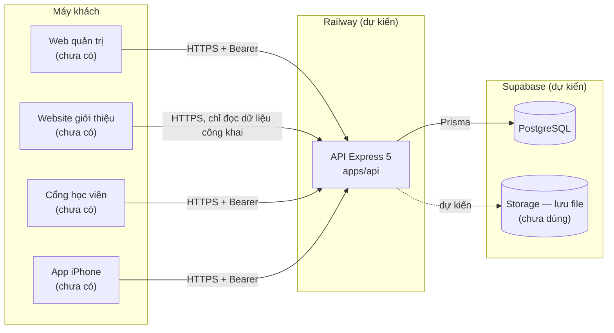

# Kiến trúc — Makeup Pro

Ngày viết: 18/10/2026. Mã đổi thì phải sửa tài liệu này cùng lần.

> **Mốc dẫn chứng:** mọi `tệp:dòng` trong tài liệu này đúng với commit `f7b0805` (15:29 UTC ngày 18/10/2026). Lúc viết, các thợ khác đang sửa nhiều tệp lõi (chưa lưu vào kho, kể cả sửa theo biên bản nghiệm thu mốc 2); khi các sửa đó được lưu, số dòng có thể lệch và điều phối cần dò lại.

---

## Phần CỦA NGHỀ — studio nào cũng dùng được

### 1. Vài từ phải biết
| Từ | Nghĩa bằng lời thường |
|---|---|
| API | "Quầy giao dịch" của máy chủ. Web, app điện thoại đều phải đến quầy này mới lấy hoặc ghi được dữ liệu. |
| Database | Kho sổ sách. Ở đây dùng PostgreSQL. |
| Tổ chức | Một studio / một thợ cá nhân / một trung tâm đào tạo. Dữ liệu của mỗi tổ chức phải tách nhau. |
| Thẻ đăng nhập (token) | Chuỗi ký tự máy chủ đưa sau khi đăng nhập. Mỗi lần gọi API phải trình thẻ. |
| Monorepo | Một kho mã chứa nhiều phần (máy chủ, web, mã dùng chung) để sửa một chỗ là các phần cùng thấy. |
| Migration | Một tệp ghi "đổi cấu trúc database thế nào". Xếp theo thứ tự, lùi lại và kiểm tra được. |

### 2. Luật kiến trúc cho phần mềm nhiều tổ chức
| # | Luật | Vì sao |
|---|---|---|
| 1 | Chỉ có một cửa vào dữ liệu: API. Web và app không nói chuyện thẳng với database. | Kiểm quyền ở một chỗ. Thêm cửa thứ hai là thêm chỗ quên kiểm. |
| 2 | Quyền tra lại từ database ở **mỗi** yêu cầu, không tin số liệu máy khách gửi lên. | Người bị cho nghỉ phải mất quyền ngay, không đợi thẻ hết hạn. |
| 3 | Đường API nào thuộc tổ chức thì bắt buộc khai quyền, khai thiếu thì máy chủ **không khởi động**. | Quên khai quyền là lỗi chết người, phải chặn từ lúc lắp ráp. |
| 4 | Database tự chặn những sai lầm nặng nhất (gắn dữ liệu chéo tổ chức, trùng lịch, sửa sổ lịch sử), không chỉ trông vào mã máy chủ. | Mã có lúc sai. Chốt ở database là lớp thứ hai. |
| 5 | Mỗi thay đổi ghi nhật ký trong cùng một giao dịch với thay đổi đó. | Thay đổi thất bại thì không có nhật ký "ma"; thay đổi thành công thì chắc chắn có nhật ký. |
| 6 | Mỗi quyết định kiến trúc ghi kèm **ngày** và **lý do**. | Sau này biết cái gì là cố ý, cái gì là tạm. |

### 3. Một yêu cầu đi qua máy chủ thế nào (mẫu chung)
Mã số yêu cầu → ghi log → xác thực thẻ → tra quyền trong tổ chức từ database → kiểm dữ liệu gửi lên → xử lý → ghi nhật ký. Thứ tự này có chủ đích: **kiểm quyền trước, kiểm dữ liệu sau**, để người ngoài không dò được cấu trúc dữ liệu qua thông báo lỗi.

---

## Phần CỦA RIÊNG DỰ ÁN NÀY

### 1. Sơ đồ thành phần

Hiện chỉ có **API + PostgreSQL**. Bốn máy khách đều chưa có mã. Web quản trị đang ở bước R&D giao diện (`docs/rnd/`). Vercel dự kiến chứa web; Railway chứa API; Supabase chứa database — chưa tạo môi trường nào (xem `docs/DEPLOYMENT.md`).

### 2. Cấu trúc kho (đúng như hiện có)
```
/                         gói gốc "makeup-pro", pnpm workspace, Node >= 22
├── package.json          lệnh chung: typecheck, test, build (chạy cho mọi gói)
├── pnpm-workspace.yaml   khai apps/* và packages/*
├── tsconfig.base.json    TypeScript chế độ nghiêm (strict, noUncheckedIndexedAccess)
├── apps/
│   └── api/              @makeup/api — máy chủ API
│       ├── prisma/
│       │   ├── schema.prisma          cấu trúc dữ liệu
│       │   └── migrations/            lịch sử đổi cấu trúc (3 thư mục lúc viết)
│       ├── src/
│       │   ├── server.ts              khởi động, tắt êm khi nhận SIGTERM
│       │   ├── app.ts                 lắp ráp: middleware, bảng đường API, chống gửi trùng
│       │   ├── env.ts                 đọc và kiểm biến môi trường
│       │   ├── http/                  route.ts (khai đường), middleware.ts (cửa gác), openapi.ts
│       │   ├── lib/                   prisma, logger, tokens, password, audit, errors
│       │   ├── modules/
│       │   │   ├── auth/              đăng ký, đăng nhập, thẻ
│       │   │   ├── orgs/              tổ chức, nhân sự, vai trò, nhật ký
│       │   │   ├── catalog/           bảng giá — ĐANG DỰNG
│       │   │   ├── contracts/         hợp đồng — ĐANG DỰNG
│       │   │   └── schedule/          khách hàng + lịch — ĐANG DỰNG
│       │   └── scripts/               sync-system-roles (đồng bộ vai trò mẫu, bổ sung dữ liệu mẫu)
│       ├── test/                      bài thử chạy trên database thật
│       ├── tsup.config.ts             đóng gói bản chạy thật
│       └── vitest.config.ts           cấu hình bài thử
├── packages/
│   └── shared/           @makeup/shared — mã dùng chung máy chủ và giao diện
│       └── src/          permissions.ts (danh mục quyền), money.ts (tiền VND),
│                         schedule.ts (trạng thái lịch), contract.ts (tính tiền hợp đồng, phí di chuyển) — hai tệp sau đang dựng
└── docs/                 tài liệu
```
Chưa có: `apps/web`, website giới thiệu, cổng học viên, app iPhone.

Bộ công nghệ: Node 22, TypeScript 5.9, Express 5.3, Prisma 6.19.3, PostgreSQL (thử trên 16.15), Zod 4 (kiểm dữ liệu), pino (log), helmet, express-rate-limit, bcryptjs, jsonwebtoken, Vitest 3 + supertest (bài thử), tsup (đóng gói).

### 3. Đường đi của một yêu cầu — dẫn chứng trong mã
| Bước | Làm gì | Ở đâu |
|---|---|---|
| 1. Mã số yêu cầu | Nhận `x-request-id` nếu hợp lệ (8–64 ký tự chữ/số/gạch), không thì tự sinh; trả lại trong header | `apps/api/src/http/middleware.ts:10-16`, gắn ở `app.ts:24` |
| 2. Ghi log | Log JSON kèm mã số yêu cầu; che header `authorization`, `cookie`, mật khẩu, thẻ | `app.ts:25`, `lib/logger.ts:4-19` |
| 3. Lớp bảo vệ chung | helmet (header an toàn), CORS theo danh sách, giới hạn thân yêu cầu 100KB | `app.ts:26-29` |
| 4. Giới hạn tốc độ | Riêng các đường đăng ký/đăng nhập/đổi thẻ: mặc định 10 lần/phút | `app.ts:31-37`, `app.ts:50` |
| 5. Xác thực | Kiểm thẻ (chỉ nhận thuật toán HS256), rồi tra database xem tài khoản còn hoạt động | `middleware.ts:18-29`, `lib/tokens.ts:13-24`, gọi ở `app.ts:52` |
| 6. Tra quyền tổ chức | Tìm tư cách thành viên theo cặp (tổ chức, người dùng) **trong database**; tổ chức không tồn tại và "không phải thành viên" trả cùng lỗi 404; gom quyền từ các vai trò, bỏ qua khoá quyền lạ; thiếu quyền → 403 | `middleware.ts:34-75`, gọi ở `app.ts:53-56` |
| 7. Chống gửi trùng | Đường có cờ `idempotent`: bắt header `Idempotency-Key`, giữ chỗ trước khi xử lý | `app.ts:68`, `app.ts:84-132` |
| 8. Kiểm dữ liệu | Kiểm thân, tham số đường, tham số truy vấn bằng Zod | `app.ts:62-64` |
| 9. Xử lý | Hàm xử lý của từng đường, thường trong một giao dịch database | `modules/*/routes.ts` |
| 10. Nhật ký | `writeAudit` nhận chính giao dịch đó, nên nhật ký và thay đổi cùng thành công hoặc cùng thất bại | `lib/audit.ts:13-16` |
| 11. Lỗi | Mọi lỗi đổi thành dạng `{error:{code,message,details,requestId}}` | `middleware.ts:77-99` |

Luật lắp ráp chặn khai sai (`apps/api/src/http/route.ts:62-83`): đường thuộc tổ chức mà không khai quyền, hoặc không nằm dưới `/orgs/:orgId`, thì ném lỗi ngay khi nạp mã → máy chủ không chạy.

### 4. Các quyết định kiến trúc
Tất cả ngày 18/10/2026. Giờ theo UTC lấy từ `docs/NHAT-KY-QUYET-DINH-THAY.md` khi có.

| # | Quyết định | Lý do | Cái giá / khi nào xem lại |
|---|---|---|---|
| 1 | Xây mới ở kho `SSSTUDIO96/a`, không sửa `ssaas` | Khảo sát: `ssaas` lưu tiền bằng số thực, một tài khoản gắn cứng một studio, không có migration (`docs/PROJECT_AUDIT.md`) | Phải viết lại đăng nhập/phân quyền; giữ được bộ công nghệ quen |
| 2 | Prisma 6.19.3, chưa lên 7 (15:02) | API bản 6 đã biết và dùng ổn ở Studio Pro; bản 7 đổi cách kết nối, rủi ro chưa đo | Nâng cấp có chủ đích sau, kèm chạy lại toàn bộ bài thử |
| 3 | Quyền lưu dạng **mảng khoá** trong cột `roles.permissions`, không làm bảng `role_permissions` riêng | Đọc quyền của một người chỉ cần một lần tra (thành viên → vai trò → mảng quyền); danh mục quyền đã nằm trong mã nên không cần bảng danh mục trong database | Database **không tự chặn** khoá lạ. Bù lại: máy chủ từ chối khoá lạ khi tạo/sửa vai trò (`modules/orgs/routes.ts:446-452`) và bỏ qua khoá lạ khi tra quyền (`middleware.ts:62-64`) |
| 4 | **Danh mục quyền là mã nguồn** (`packages/shared/src/permissions.ts:3-23`) | Quyền gắn chặt với đường API trong mã; giao diện và máy chủ đọc cùng một danh mục | Thêm quyền = sửa mã + triển khai + chạy `db:sync-roles` cho tổ chức cũ (xem `docs/SO-LOI-DA-DO.md`, lỗi 3) |
| 5 | Vai trò mẫu **chép** vào từng tổ chức lúc tạo; vai trò hệ thống không sửa được qua API (15:17) | Mỗi tổ chức tự quản vai trò tuỳ chỉnh của mình; vai trò mẫu giữ đúng chuẩn | Lệnh `db:sync-roles` (`apps/api/src/scripts/sync-system-roles.ts`) ghi đè vai trò hệ thống theo mẫu |
| 6 | Thẻ truy cập JWT 15 phút + refresh token 30 ngày, xoay vòng mỗi lần dùng, dùng lại thẻ cũ thì thu hồi cả họ thẻ | Thẻ ngắn hạn giảm thiệt hại khi lộ; phát hiện thẻ bị đánh cắp | Đăng xuất chỉ thu hồi refresh token; thẻ truy cập đang cầm còn dùng được tối đa 15 phút |
| 7 | **Refresh token gửi trong thân yêu cầu** (JSON), không phải cookie | Hợp với app iPhone (cất trong Keychain) và bài thử | **Phải chuyển sang cookie httpOnly** (Secure, SameSite) khi làm web quản trị, vì để thẻ trong bộ nhớ trình duyệt thì mã độc trên trang đọc được. Hiện CORS đang `credentials: false` (`app.ts:28`) |
| 8 | **RLS chưa bật.** RLS (Row Level Security) là luật lọc theo tổ chức đặt ngay trong PostgreSQL | API là cửa duy nhất vào database, dùng một tài khoản database; cách ly đã làm ở hai lớp: cửa gác API (`middleware.ts:34-75`) + khoá ngoại kép ở database. Bật RLS với Prisma cần đặt biến phiên trong mỗi giao dịch, phức tạp hơn khi đi qua pooler của Supabase | Cân nhắc bật khi: (a) có đường vào database không qua API (web/app gọi thẳng Supabase, công cụ báo cáo, Supabase Storage có luật theo tổ chức); hoặc (b) làm module tài chính; hoặc (c) sau bất kỳ sự cố lộ dữ liệu nào |
| 9 | Mọi bảng nghiệp vụ có `organization_id`, mọi liên kết giữa hai bảng nghiệp vụ dùng **khoá ngoại kép** (id, organization_id) | Database tự chặn gắn dữ liệu của tổ chức A vào tổ chức B | Mỗi bảng phải có thêm chỉ mục duy nhất (id, organization_id) |
| 10 | Tiền là `BigInt` đơn vị đồng | Không lệch đồng nào khi cộng trừ | Khi trả JSON phải đổi sang số, vượt ngưỡng thì ném lỗi (`packages/shared/src/money.ts:12-17`) |
| 11 | Chặn trùng lịch bằng ràng buộc EXCLUDE trong database | Hai người bấm lưu cùng giây cũng chỉ một lịch lọt | Cần extension `btree_gist`, phải bật trước trên Supabase |
| 12 | Lịch nháp không chiếm giờ thợ; từ "chờ xác nhận" trở lên mới chiếm (15:14) | Nháp chưa hứa với khách | Đổi bằng một dòng điều kiện |
| 13 | Trạng thái thực hiện tách khỏi thanh toán (15:14) | Thanh toán sẽ suy ra từ sổ giao dịch của module tài chính | Lát 1 chưa xem được "đã cọc chưa" trên lịch |
| 14 | Bắt buộc `Idempotency-Key` cho các đường POST tạo lịch (15:15) | Bấm "Lưu" hai lần / mạng gửi lại không tạo hai bản ghi | Máy khách phải sinh khoá mới cho mỗi lần bấm |
| 15 | Tài liệu OpenAPI sinh thẳng từ bảng đường API (`http/openapi.ts:4-40`) | Không có bản viết tay để lệch khỏi mã | Chưa mô tả dạng dữ liệu trả về |
| 16 | Database thử chỉ chạy `migrate deploy`, không xoá trắng (15:09) | Prisma chặn AI chạy lệnh xoá trắng; không lách bằng lời đồng ý giả | Database thử tích dữ liệu dần; mỗi bài thử tự tạo dữ liệu mã ngẫu nhiên |
| 17 | Không xoá dây chuyền dữ liệu nghiệp vụ (`schema.prisma:3`) | Xoá nhầm một tổ chức/khách không được kéo theo cả sổ sách | Muốn xoá phải xoá từng phần có chủ đích; chỉ vài bảng "con trực tiếp" có xoá theo (liệt kê trong `docs/DATABASE_SCHEMA.md`) |
| 18 | **Tiền chỉ nằm ở hợp đồng**; lịch chỉ giữ giờ, thợ, địa điểm (15:20–15:21) | Một công thức tiền duy nhất; lịch giữ tiền song song với hợp đồng sẽ lệch nhau | Bỏ bảng `appointment_items` và các cột tiền của lịch bằng migration mới, không sửa migration cũ |
| 19 | Công thức tính tiền hợp đồng và phí di chuyển đặt ở `packages/shared` | Máy chủ và giao diện tính cùng một cách; số trên màn khớp số máy chủ lưu | Đang dựng |
