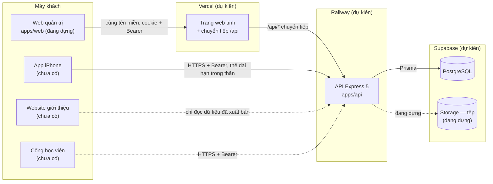

# Kiến trúc — Makeup Pro

Cập nhật: 18/10/2026. **Đã đối chiếu với commit `634d6a3`** (17:00 UTC; mã giống hệt `bc9633a`, hai commit sau chỉ thêm sổ ghi). Mọi `tệp:dòng` đúng với commit đó. Mã đổi thì sửa tài liệu này cùng lần.

---

## Phần CỦA NGHỀ — studio nào cũng dùng được

### 1. Vài từ phải biết
| Từ | Nghĩa bằng lời thường |
|---|---|
| API | "Quầy giao dịch" của máy chủ. Web, app điện thoại đều phải qua quầy này mới đọc/ghi được dữ liệu |
| Database | Kho sổ sách. Ở đây là PostgreSQL |
| Tổ chức | Một studio / một thợ cá nhân / một trung tâm. Dữ liệu mỗi tổ chức tách nhau |
| Thẻ đăng nhập (token) | Chuỗi ký tự máy chủ đưa sau khi đăng nhập; mỗi lần gọi API phải trình thẻ |
| Cookie httpOnly | Ngăn chứa do máy chủ đặt vào trình duyệt; mã chạy trên trang web **không đọc được**, nên mã độc chèn vào trang không lấy trộm được |
| Monorepo | Một kho mã chứa nhiều phần (máy chủ, web, mã dùng chung) |
| Migration | Tệp ghi "đổi cấu trúc database thế nào", xếp theo thứ tự |

### 2. Luật kiến trúc cho phần mềm nhiều tổ chức
| # | Luật | Vì sao |
|---|---|---|
| 1 | Một cửa vào dữ liệu: API. Web và app không nói chuyện thẳng với database | Kiểm quyền một chỗ |
| 2 | Quyền tra lại từ database ở **mỗi** yêu cầu, và tra lại **lần nữa** sau khi khoá tổ chức với thao tác đổi người/vai trò | Người bị hạ quyền giữa chừng không ra lệnh tiếp được |
| 3 | Đường API thuộc tổ chức bắt buộc khai quyền; khai thiếu thì máy chủ **không khởi động** | Quên kiểm quyền bị chặn từ lúc lắp ráp |
| 4 | Database tự chặn sai lầm nặng (gắn chéo tổ chức, trùng lịch, sửa sổ tiền, sửa sổ lịch sử) | Mã có lúc sai; database là lớp thứ hai |
| 5 | Nhật ký ghi trong cùng giao dịch với thay đổi | Không có nhật ký "ma", không mất nhật ký |
| 6 | Web gọi API **cùng tên miền** | Cookie an toàn nhất khi cùng tên miền; không phải mở cửa cho trang lạ |
| 7 | Mỗi quyết định ghi kèm ngày và lý do | Biết cái gì là cố ý, cái gì là tạm |

### 3. Một yêu cầu đi qua máy chủ thế nào (mẫu chung)
Mã số yêu cầu → ghi log → xác thực thẻ → tra quyền trong tổ chức từ database → (giữ chỗ chống gửi trùng) → kiểm dữ liệu → xử lý trong giao dịch → ghi nhật ký → đổi lỗi thành lời người đọc được. **Kiểm quyền trước, kiểm dữ liệu sau**, để người ngoài không dò được cấu trúc dữ liệu qua lời báo lỗi.

---

## Phần CỦA RIÊNG DỰ ÁN NÀY

### 1. Sơ đồ thành phần

Đã có mã: **API + PostgreSQL + web quản trị** (móng, gọi API, bộ component, khung điều hướng; chưa có màn nghiệp vụ). Website giới thiệu, cổng học viên, app iPhone chưa có mã. Chưa tạo Supabase, Railway, Vercel (`docs/DEPLOYMENT.md`).

### 2. Cấu trúc kho
```
/                         gói "makeup-pro", pnpm workspace, Node >= 22
├── apps/
│   ├── api/              @makeup/api — máy chủ
│   │   ├── prisma/       schema.prisma + 9 migration
│   │   ├── src/
│   │   │   ├── app.ts                 lắp ráp: middleware, bảng đường, chống gửi trùng, cookie
│   │   │   ├── server.ts, env.ts
│   │   │   ├── http/                  route.ts (khai đường), middleware.ts (cửa gác, bắt lỗi), openapi.ts
│   │   │   ├── lib/                   prisma, logger, tokens, password, audit, errors, quota (hạn mức gói), storage (kho tệp: ổ đĩa hoặc S3)
│   │   │   ├── modules/
│   │   │   │   ├── auth/              đăng ký, đăng nhập, thẻ; transport.ts (thân hay cookie)
│   │   │   │   ├── orgs/              tổ chức, nhân sự, vai trò, nhật ký
│   │   │   │   ├── catalog/           bảng giá, nhân vật, studio, phí di chuyển
│   │   │   │   ├── schedule/          khách hàng, lịch
│   │   │   │   ├── contracts/         hợp đồng
│   │   │   │   ├── staff/             bậc lương, hồ sơ thợ, mức rảnh, tiền công
│   │   │   │   ├── files/             tải tệp, xem tệp (đường đọc có hạn), xoá mềm
│   │   │   │   ├── platform/          quản trị nền tảng: tổ chức thuê, gói, thống kê
│   │   │   │   ├── payments/, profile/   khung rỗng trong kho — đang viết
│   │   │   └── scripts/               đồng bộ vai trò mẫu (có bản build chạy thật), cấp quyền quản trị nền tảng, tạo gói mẫu
│   │   └── test/                      bài thử chạy trên database thật, cửa gác cách ly
│   └── web/              @makeup/web — web quản trị (Vite 7 + React 19 + React Router 7)
│       ├── src/api/      gọi API: thẻ trong bộ nhớ, refresh xếp hàng, khoá chống gửi trùng
│       ├── src/ui/       bộ component (W2)
│       ├── src/layout/   khung điều hướng (W3)
│       ├── src/features/auth/   đăng nhập, đăng ký, tạo tổ chức
│       ├── scripts/      cửa gác bí mật trong bản build; ghi/kiểm vercel.json
│       ├── e2e/          Playwright
│       └── vercel.json   chuyển /api sang Railway
├── packages/shared/      @makeup/shared — danh mục quyền, tiền VND, bảng chuyển trạng thái lịch, công thức tiền hợp đồng và phí di chuyển
└── docs/
```
Bộ công nghệ: Node 22, TypeScript 5.9, Express 5.3, Prisma 6.19.3, PostgreSQL (thử trên 16), Zod 4, pino, helmet, express-rate-limit, bcryptjs, jsonwebtoken; web: Vite 7, React 19.2, React Router 7; thử: Vitest 3, supertest, Testing Library, Playwright.

### 3. Đường đi của một yêu cầu — dẫn chứng
| Bước | Làm gì | Ở đâu (`apps/api/src/`) |
|---|---|---|
| 1. Mã số yêu cầu | Nhận `x-request-id` hợp lệ hoặc tự sinh; trả lại trong header | `http/middleware.ts:10-16`, `app.ts:32` |
| 2. Ghi log | Log JSON kèm mã số; che header đăng nhập, cookie, mật khẩu, thẻ | `app.ts:33`, `lib/logger.ts:4-19` |
| 3. Lớp chung | helmet, CORS theo danh sách (mặc định rỗng), thân ≤ 100KB, chặn ký tự `\u0000` | `app.ts:34-47` |
| 4. Giới hạn tốc độ | Đăng ký/đăng nhập/đổi thẻ: mặc định 10 lần/phút/IP; IP thật chỉ lấy qua đúng số tầng proxy khai ở `TRUST_PROXY_HOPS` | `app.ts:31`, `app.ts:49-55`, `app.ts:68` |
| 5. Xác thực | Kiểm thẻ HS256, tra database xem tài khoản còn hoạt động | `http/middleware.ts:18-29`, `app.ts:70` |
| 6a. Quản trị nền tảng | Đường `/platform/...`: không có tên trong `platform_admins` → 404 như "không có đường" | `app.ts:71-74` |
| 6b. Tra quyền tổ chức | Tư cách thành viên theo cặp (tổ chức, người); không phải thành viên = 404; thiếu quyền = 403 | `http/middleware.ts:35-77`, `app.ts:75-83` |
| 7. Chống gửi trùng | Đường có cờ `idempotent`: bắt `Idempotency-Key`, so đường dẫn thật + nội dung | `app.ts:95`, `app.ts:121-178` |
| 8. Kiểm dữ liệu | Thân, tham số đường, tham số truy vấn bằng Zod, lời báo tiếng Việt | `app.ts:24`, `app.ts:84-94` |
| 9. Xử lý | Trong giao dịch; thao tác đổi người/vai trò khoá dòng tổ chức rồi tra quyền lại | `http/middleware.ts:174-181`; ví dụ `modules/orgs/routes.ts:212` |
| 10. Nhật ký | `writeAudit` dùng chính giao dịch đó | `lib/audit.ts:14` |
| 11. Cookie | Kết quả có lệnh cookie → đặt cookie httpOnly, SameSite=Strict, Secure khi chạy thật | `app.ts:96-105` |
| 12. Lỗi | Mọi lỗi về dạng `{error:{code,message,details,requestId}}`; lỗi database đã biết đổi sang 400/409 | `http/middleware.ts:79-107`, `153-169` |

Luật lắp ráp (`http/route.ts:73-109`): đường thuộc tổ chức phải khai quyền và nằm dưới `/orgs/:orgId`; đường `/platform/...` phải khai phạm vi "platform" và không khai quyền tổ chức; đường có `:orgId` mà không khai phạm vi tổ chức → máy chủ không chạy.

### 4. Web gọi API
| Việc | Cách làm | Ở đâu (`apps/web/`) |
|---|---|---|
| Địa chỉ | Luôn gọi đường tương đối `/api/v1/...`; không có địa chỉ máy chủ trong mã web | `README.md` |
| Lúc phát triển | Vite chuyển `/api` sang `http://localhost:4000` | `vite.config.ts:6`, `:13-14` |
| Trên Vercel | `vercel.json` chuyển `/api/(.*)` sang máy chủ Railway; build dừng nếu địa chỉ chưa đặt | `vercel.json`, `scripts/vercel-config.mjs` |
| Thẻ truy cập | Chỉ nằm trong biến bộ nhớ; không dùng localStorage | `src/api/client.ts:9` |
| Thẻ dài hạn | Cookie `mp_refresh` do máy chủ đặt khi có header `X-Client: web` | `src/api/client.ts:40`, `apps/api/src/modules/auth/transport.ts:11-37` |
| localStorage | Chỉ giữ id tổ chức đang chọn | `src/app/session.tsx:13`, `:21` |

### 5. Quyết định kiến trúc
Tất cả ngày 18/10/2026; giờ UTC theo `docs/NHAT-KY-QUYET-DINH-THAY.md` khi có.

| # | Quyết định | Lý do | Cái giá / khi nào xem lại |
|---|---|---|---|
| 1 | Xây mới ở kho `SSSTUDIO96/a`, không sửa `ssaas` | `ssaas` lưu tiền số thực, một tài khoản gắn một studio, không migration (`docs/PROJECT_AUDIT.md`) | Viết lại đăng nhập/phân quyền |
| 2 | Prisma 6.19.3, chưa lên 7 (15:02) | API bản 6 đã biết và dùng ổn ở Studio Pro; bản 7 đổi cách kết nối, rủi ro chưa đo | Nâng cấp có chủ đích sau, chạy lại toàn bộ bài thử |
| 3 | Quyền lưu **mảng khoá** trong `roles.permissions`, không có bảng `role_permissions` | Một lần tra là đủ; danh mục quyền nằm trong mã | Database không tự chặn khoá lạ → máy chủ từ chối khi ghi (`modules/orgs/routes.ts:459`) và bỏ qua khi tra (`http/middleware.ts:62-66`) |
| 4 | **Danh mục quyền là mã nguồn** (`packages/shared/src/permissions.ts:3-34`) | Quyền gắn với đường API trong mã; web và máy chủ đọc cùng danh mục | Thêm quyền = sửa mã + triển khai + chạy `db:sync-roles:prod` |
| 5 | Vai trò mẫu chép vào từng tổ chức; vai trò hệ thống không sửa qua API (15:17) | Mỗi tổ chức tự quản vai trò tuỳ chỉnh | Lệnh đồng bộ ghi đè vai trò hệ thống theo mẫu |
| 6 | Thẻ truy cập 15 phút + thẻ dài hạn 30 ngày xoay vòng; chỉ thẻ bị thu hồi **do xoay vòng** mà dùng lại mới tính là bị đánh cắp | Phát hiện trộm thẻ, không báo nhầm khi dùng lại thẻ đã đăng xuất | Đăng xuất không huỷ được thẻ truy cập đang cầm (tối đa 15 phút) |
| 7 | **Web: thẻ dài hạn chỉ trong cookie httpOnly**, SameSite=Strict, chỉ đường `/api/v1/auth`; web phải gửi `X-Client: web`. App điện thoại vẫn nhận trong thân (16:20) | Mã độc trên trang không lấy được thẻ dài hạn; header bắt buộc chặn trang lạ giả yêu cầu | Đổi thẻ thành công chưa ghi nhật ký |
| 8 | **Web gọi `/api` cùng tên miền**, Vercel chuyển sang Railway (16:20) | Cookie cùng trang; không mở CORS cho trình duyệt | Thêm một chặng chuyển tiếp; phải ghi địa chỉ Railway vào `vercel.json` |
| 9 | **RLS chưa bật.** RLS là luật lọc theo tổ chức đặt ngay trong PostgreSQL | API là cửa duy nhất, một tài khoản database; cách ly ở cửa gác API + khoá ngoại kép. Bật RLS với Prisma cần đặt biến phiên mỗi giao dịch, phức tạp qua pooler | Xem lại khi: có đường vào database không qua API (Supabase Storage có luật theo tổ chức, công cụ báo cáo); làm báo cáo doanh thu; hoặc sau bất kỳ sự cố lộ dữ liệu |
| 10 | Mọi liên kết giữa hai bảng nghiệp vụ dùng **khoá ngoại kép** (id, organization_id) | Database tự chặn gắn chéo tổ chức | Mỗi bảng thêm chỉ mục duy nhất (id, organization_id) |
| 11 | Tiền là `BigInt` đồng | Không lệch đồng nào | Trả JSON phải đổi sang số, vượt ngưỡng thì ném lỗi |
| 12 | Chặn trùng lịch bằng EXCLUDE; **khoảng bận do database tự tính** từ giờ lịch, phút di chuyển, trạng thái | Đường sửa nào quên tính lại cũng không lọt trùng (migration `20261018160000_chot_chan_database:53-88`) | Cần extension `btree_gist` |
| 13 | **Tiền chỉ nằm ở hợp đồng**; lịch giữ giờ, thợ, nơi (15:20) | Một công thức tiền duy nhất | Lịch không tự biết giá |
| 14 | **Khoá hợp đồng ở database**: dòng đã xác nhận không sửa/xoá; hợp đồng đã xác nhận không về nháp, giảm giá và cọc chỉ hạ; tổng phải khớp các dòng lúc lưu | Biên bản lát 1, lỗi N3 (migration `20261018170000_khoa_tien_hop_dong`) | Mọi đường ghi phải cập nhật tổng trong cùng giao dịch |
| 15 | Phiếu thu **chỉ ghi thêm**, ghi sai thì huỷ có lý do | Sổ tiền làm bằng chứng | Migration `20261018190000_tep_thu_tien_nen_tang:206-220` |
| 16 | Quản trị nền tảng bằng bảng `platform_admins` + tài khoản riêng, **không** mật khẩu dùng chung | Lỗi cũ của Studio Pro (`docs/PROJECT_AUDIT.md`, mục 6) | Máy chủ có 8 đường `/platform/...`; chưa có giao diện, R&D chưa vẽ |
| 17 | Bắt `Idempotency-Key` cho 12 đường tạo; so **đường dẫn thật** kèm id (15:15, sửa T1) | Bấm "Lưu" hai lần không tạo hai bản ghi; cùng khoá gửi vào hai hợp đồng khác nhau không báo thành công giả | Máy chủ chết sau khi ghi và trước khi lưu kết quả thì gửi lại có thể tạo bản thứ hai (`app.ts:155-156`) |
| 18 | Lỗi database đã biết đổi thành lời người đọc: trùng lịch, trigger → 409; CHECK, khoá ngoại → 400 | Không để lọt 500 | Lời của trigger trả thẳng cho người dùng (`http/middleware.ts:157-158`) |
| 19 | `TRUST_PROXY_HOPS` mặc định 0 (biên bản mốc 2, L7) | Không tin IP do máy khách tự khai, chống lách giới hạn tốc độ | Railway phải đặt 1 |
| 20 | Lệnh đồng bộ vai trò được đóng gói vào bản build (`tsup.config.ts:5`) | Chạy được trên máy thật không cần công cụ phát triển | `db:sync-roles:prod` |
| 21 | Database thử chỉ chạy `migrate deploy`, không xoá trắng (15:09) | Prisma chặn AI xoá trắng database | Database thử tích dữ liệu dần |
| 22 | Không xoá dây chuyền sổ sách (`schema.prisma:3`) | Xoá nhầm không kéo theo cả sổ | Chỉ 4 chỗ xoá theo con trực tiếp (`docs/DATABASE_SCHEMA.md`) |
