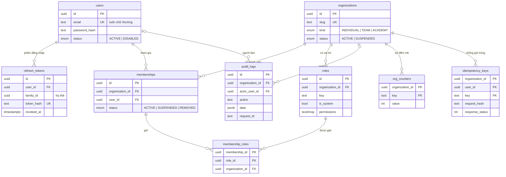
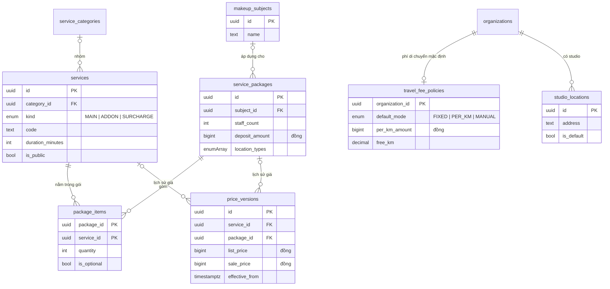
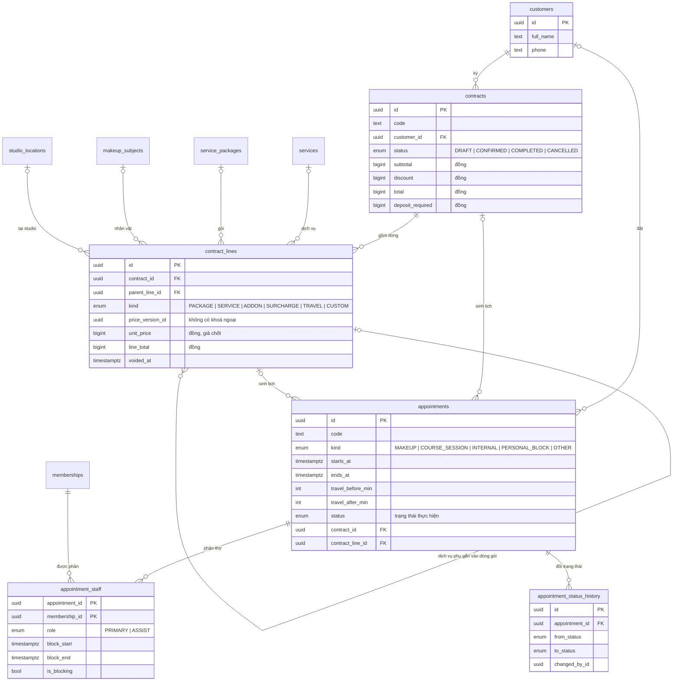

# Cấu trúc dữ liệu — Makeup Pro

Ngày viết: 18/10/2026. Nguồn: `apps/api/prisma/schema.prisma` và 3 migration trong `apps/api/prisma/migrations/`.

> Tài liệu này mô tả cấu trúc **sau khi** áp cả 3 migration: `20261018150452_nen_mong`, `20261018151403_bang_gia_lich`, `20261018152236_hop_dong_nhan_vat` (migration thứ ba thêm hợp đồng, nhân vật makeup, địa điểm, phí di chuyển; lưu vào kho ở commit `af43d6e`). Đã thử áp cả 3 migration lên một database trống trên máy đám mây ngày 18/10/2026: chạy hết, ra 23 bảng.
>
> **Đang thay đổi lúc viết:** có migration thứ tư `20261018153348_nhan_su_bac_luong` (bảng `staff_tiers`, `staff_profiles`, `staff_pay_rates` — hồ sơ thợ, bậc, tiền công theo gói) **chưa lưu vào kho**, chưa đưa vào tài liệu này. Dòng `schema.prisma:…` dẫn theo commit `f7b0805`.

---

## Phần CỦA NGHỀ — studio nào cũng dùng được

### 1. Vài từ phải biết
| Từ | Nghĩa bằng lời thường |
|---|---|
| Bảng | Một quyển sổ, mỗi dòng là một bản ghi (một khách, một lịch…) |
| Khoá chính | Số căn cước của một dòng, không trùng |
| Khoá ngoại | Dòng này "trỏ" sang dòng ở sổ khác. Database không cho trỏ tới dòng không có thật |
| Khoá ngoại kép | Trỏ bằng **hai** cột cùng lúc: mã bản ghi + mã tổ chức. Hai bên phải cùng tổ chức thì mới khớp |
| CHECK | Luật viết thẳng vào database, ví dụ "tiền không âm". Dòng sai luật bị từ chối, dù mã máy chủ có lỗi |
| Trigger | Đoạn lệnh database tự chạy khi có người sửa/xoá, ở đây dùng để **cấm** sửa/xoá |
| EXCLUDE | Luật "hai dòng không được chồng nhau", ở đây dùng để chặn trùng lịch |
| Xoá dây chuyền (cascade) | Xoá dòng cha thì database tự xoá các dòng con |

### 2. Luật dữ liệu cho phần mềm nhiều tổ chức
| # | Luật | Vì sao |
|---|---|---|
| 1 | Mọi bảng nghiệp vụ có cột mã tổ chức | Lọc theo tổ chức ở mọi câu hỏi |
| 2 | Liên kết giữa hai bảng nghiệp vụ dùng khoá ngoại kép | Database tự chặn gắn dữ liệu tổ chức A vào tổ chức B, kể cả khi mã máy chủ quên kiểm |
| 3 | Tiền lưu số nguyên đồng | Số thực cộng trừ nhiều lần lệch vài đồng |
| 4 | Sổ lịch sử (giá, nhật ký) chỉ ghi thêm | Sửa được sổ lịch sử thì sổ mất giá trị làm bằng chứng |
| 5 | Giá được **chốt** vào đơn lúc chốt với khách | Đổi bảng giá hôm nay không được làm đổi đơn đã ký hôm qua |
| 6 | Trùng lịch chặn ở database | Hai lễ tân bấm lưu cùng một giây vẫn chỉ một lịch lọt |
| 7 | Không xoá dây chuyền sổ sách | Xoá nhầm một khách không được kéo theo hợp đồng, lịch của khách đó |
| 8 | Thời gian lưu theo UTC kèm múi giờ | Không lệch giờ khi máy chủ đặt ở nước khác |

---

## Phần CỦA RIÊNG DỰ ÁN NÀY

### 1. Danh sách 23 bảng
Ngoài 23 bảng dưới đây còn bảng `_prisma_migrations` do Prisma tự quản, ghi migration nào đã áp.

| Nhóm | Bảng | Giữ gì |
|---|---|---|
| Tài khoản | `users` | Tài khoản đăng nhập: email (luôn chữ thường), mật khẩu đã băm, họ tên |
| | `refresh_tokens` | Phiên đăng nhập dài hạn: chỉ giữ bản băm của thẻ, "họ" thẻ, hạn, thời điểm thu hồi |
| Tổ chức | `organizations` | Studio / thợ cá nhân / trung tâm: tên, slug (dùng làm tên miền con), loại, múi giờ, tiền tệ |
| | `memberships` | Một người thuộc một tổ chức: trạng thái hoạt động / tạm khoá / đã rời |
| | `roles` | Vai trò của từng tổ chức, cột `permissions` là mảng khoá quyền |
| | `membership_roles` | Ai giữ vai trò nào |
| | `audit_logs` | Nhật ký thay đổi: ai, làm gì, trên bản ghi nào, mã số yêu cầu |
| Bảng giá | `service_categories` | Nhóm dịch vụ |
| | `services` | Dịch vụ lẻ: mã, tên, thời lượng, loại (chính / dịch vụ phụ / phụ phí), công khai trên website hay không |
| | `service_packages` | Gói combo: thời lượng, số thợ, tiền cọc mặc định, nhân vật áp dụng, địa điểm cho phép |
| | `package_items` | Gói gồm những dịch vụ nào, bao nhiêu lần, có tuỳ chọn không |
| | `price_versions` | Lịch sử giá của dịch vụ hoặc gói: giá niêm yết, giá khuyến mại, ngày hiệu lực |
| | `makeup_subjects` | Nhân vật makeup: cô dâu, mẹ cô dâu, phù dâu… mỗi tổ chức tự đặt |
| | `studio_locations` | Studio / cửa hàng của tổ chức, điểm xuất phát tính km; tối đa một nơi mặc định |
| | `travel_fee_policies` | Cách tính phí di chuyển mặc định: cố định / theo km / nhập tay |
| Khách & hợp đồng | `customers` | Khách hàng: họ tên, số điện thoại, email |
| | `contracts` | Hợp đồng: **nơi duy nhất giữ tiền** của một đơn makeup (tạm tính, giảm giá, tổng, cọc) |
| | `contract_lines` | Từng dòng hợp đồng: gói / dịch vụ / dịch vụ phụ / phụ phí / di chuyển / dòng tự nhập; giá đã chốt |
| Lịch | `appointments` | Lịch: giờ bắt đầu–kết thúc, phút di chuyển trước/sau, địa chỉ, trạng thái thực hiện, trỏ về hợp đồng |
| | `appointment_staff` | Thợ nào làm lịch nào (chính / phụ), khoảng bận của thợ |
| | `appointment_status_history` | Lịch sử đổi trạng thái của lịch |
| Hệ thống | `org_counters` | Bộ đếm theo tổ chức để sinh mã tuần tự (ví dụ LH-000001) |
| | `idempotency_keys` | Khoá chống gửi trùng và kết quả lần đầu |

### 2. Sơ đồ quan hệ
Đọc ký hiệu: `||` = đúng một, `o|` = không hoặc một, `o{` = không hoặc nhiều.

**2a. Tài khoản, tổ chức, hệ thống**

**2b. Bảng giá, nhân vật, địa điểm** — mọi bảng ở đây đều có `organization_id` trỏ về `organizations`; không vẽ các đường đó cho đỡ rối.

**2c. Khách, hợp đồng, lịch** — mọi bảng đều có `organization_id`.

### 3. Giải thích các quan hệ quan trọng

**3.1. Khoá ngoại kép chặn gắn dữ liệu chéo tổ chức ngay trong database.**
Mỗi bảng nghiệp vụ có thêm chỉ mục duy nhất `(id, organization_id)` (ví dụ `schema.prisma:123` cho `roles`). Bảng con trỏ sang bằng **cả hai cột**. Ví dụ `membership_roles` trỏ sang `memberships` bằng (membership_id, organization_id) và sang `roles` bằng (role_id, organization_id) (`schema.prisma:152-153`). Muốn gán vai trò của tổ chức B cho người ở tổ chức A thì mã tổ chức hai bên không khớp → database từ chối.
Bằng chứng: bài thử `apps/api/test/escalation.test.ts`, ca "không gán được vai trò của tổ chức khác, kể cả ghi thẳng vào database" — ghi thẳng vào database, bỏ qua API, vẫn bị từ chối.
Cùng kiểu này áp cho: dịch vụ ↔ nhóm, gói ↔ dịch vụ, giá ↔ dịch vụ/gói, gói ↔ nhân vật, hợp đồng ↔ khách, dòng hợp đồng ↔ hợp đồng/dịch vụ/gói/nhân vật/studio/dòng cha, lịch ↔ khách/hợp đồng/dòng hợp đồng, thợ trên lịch ↔ lịch/thành viên.
Bài thử hiện chỉ chứng minh cho `membership_roles`. Các bảng bảng giá, hợp đồng, lịch **chưa có bài thử** ghi chéo tổ chức.

**3.2. Tiền là số nguyên đồng (BigInt).**
Các cột tiền: `service_packages.deposit_amount`; `price_versions.list_price`, `sale_price`; `contracts.subtotal`, `discount`, `total`, `deposit_required`; `contract_lines.unit_price`, `line_discount`, `line_total`, `per_km_amount`; `travel_fee_policies.fixed_amount`, `per_km_amount`, `minimum_amount`. Số km (`free_km`, `distance_km`) là số thập phân 2 chữ số, không phải tiền. Khi trả ra JSON, máy chủ đổi sang số; vượt ngưỡng an toàn thì ném lỗi chứ không làm tròn (`packages/shared/src/money.ts:12-17`).

**3.3. Lịch sử giá chỉ ghi thêm.**
Đổi giá = thêm một dòng `price_versions` mới có ngày hiệu lực. Trigger `price_versions_append_only` cấm sửa và xoá dòng cũ (migration `20261018151403_bang_gia_lich`, dòng 333-339). Giá hiện hành = dòng có ngày hiệu lực mới nhất mà không muộn hơn thời điểm hỏi; trùng ngày thì lấy dòng tạo sau. Công thức này chỉ viết một lần trong `apps/api/src/modules/catalog/prices.ts` (tệp đang được thợ bảng giá sửa).

**3.4. Giá chốt vào đơn — đã chuyển từ "dòng lịch" sang "dòng hợp đồng".**
- Migration 2 (`bang_gia_lich`): giá chốt nằm ở bảng `appointment_items` (dòng của lịch), tổng tiền nằm trên `appointments`.
- Migration 3 (`hop_dong_nhan_vat`, quyết định 15:20–15:21 trong `docs/NHAT-KY-QUYET-DINH-THAY.md`): **xoá** `appointment_items` và các cột tiền trên `appointments`. Giá chốt giờ nằm ở `contract_lines` (`unit_price` + `price_version_id` + tên), tiền nằm ở `contracts`. Lịch không giữ tiền; lịch trỏ về hợp đồng và dòng hợp đồng (`schema.prisma:549-550`, chú thích trên `Appointment`).
- Luật ghi trong chú thích `schema.prisma` (ngay trên `model ContractLine`): sau khi hợp đồng xác nhận thì không sửa/xoá dòng cũ, chỉ thêm dòng phát sinh hoặc huỷ dòng có lý do. **Database chỉ chặn được phần "huỷ phải có lý do"** (CHECK `contract_lines_void_reason`). Phần "không sửa/xoá dòng cũ" và "tổng hợp đồng = tổng các dòng chưa huỷ" do mã máy chủ giữ, database không kiểm.

**3.5. Chặn trùng lịch theo khoảng bận, gồm cả thời gian di chuyển.**
- Mỗi thợ trên một lịch có một dòng `appointment_staff` với **khoảng bận** = giờ bắt đầu − phút di chuyển trước → giờ kết thúc + phút di chuyển sau (`schema.prisma:401`; công thức `computeBlock` trong `packages/shared/src/schedule.ts`).
- Ràng buộc `appointment_staff_no_overlap` (migration 2, dòng 359-361): với cùng một `membership_id`, hai khoảng bận đang chiếm giờ (`is_blocking = true`) không được chồng nhau. Khoảng là nửa mở `[)`: lịch kết thúc 10:00 và lịch bắt đầu 10:00 không tính là trùng.
- `is_blocking = false` khi lịch ở trạng thái nháp, đã huỷ, khách không đến (`schema.prisma:404-405`; quyết định 15:14).
- Cần extension `btree_gist` (migration 2, dòng 358).

Ba điều chủ studio cần biết:
1. `block_start`, `block_end`, `is_blocking` là **bản sao** do máy chủ tính rồi ghi vào. Database không tự tính lại khi giờ lịch hay trạng thái đổi. Nếu mã máy chủ quên cập nhật, ràng buộc sẽ so trên số cũ.
2. Chặn trùng tính theo **tư cách thành viên trong một tổ chức**. Một thợ làm cho hai studio có hai tư cách thành viên → hai studio có thể đặt trùng giờ cùng một thợ.
3. Khi database từ chối vì trùng, PostgreSQL báo mã `23P01`; Prisma 6.19 không gán mã riêng cho lỗi này. Bộ bắt lỗi trung tâm nhận ra mã này (`apps/api/src/http/middleware.ts:105-117`) và trả **409 "Trùng lịch"** (`middleware.ts:87-88`, commit `af80a10`). Bài thử: `apps/api/test/exclusion-error.test.ts`. Các vi phạm CHECK (mã `23514`) và trigger chỉ ghi thêm (mã `P0001`) **vẫn** rơi vào 500 — đã thử trực tiếp trên database thử ngày 18/10/2026; mã máy chủ phải kiểm dữ liệu trước để không chạm tới các chốt này.

**3.6. Trạng thái thực hiện tách khỏi thanh toán.**
`WorkStatus` (`schema.prisma:341-350`) chỉ có các bước làm việc: nháp, chờ xác nhận, đã xác nhận, đang làm, hoàn thành, đã huỷ, khách không đến. Không có "đã cọc", "đã trả đủ". Trạng thái thanh toán sẽ suy ra từ sổ giao dịch của module tài chính (chưa có).

**3.7. Nhật ký chỉ ghi thêm.**
Trigger `audit_logs_no_update` cấm sửa và xoá `audit_logs` (migration `20261018150452_nen_mong`, dòng 179-186). Bằng chứng: `escalation.test.ts`, ca "nhật ký không sửa, không xoá được".

**3.8. Không xoá dây chuyền sổ sách.**
Mọi khoá ngoại đều đặt "cấm xoá cha khi còn con" (RESTRICT), **trừ 4 chỗ** xoá theo con trực tiếp:

| Xoá dòng này | Database tự xoá theo |
|---|---|
| `memberships` | `membership_roles` của thành viên đó |
| `service_packages` | `package_items` của gói đó |
| `appointments` | `appointment_staff` của lịch đó |
| `appointments` | `appointment_status_history` của lịch đó |

Bằng chứng: `escalation.test.ts`, ca "không xoá được tổ chức còn dữ liệu (không có xoá dây chuyền)".
Lưu ý: xoá một lịch sẽ xoá luôn lịch sử trạng thái của lịch đó. `appointment_status_history` **không** có trigger chỉ ghi thêm như `price_versions` và `audit_logs`.

### 4. Toàn bộ CHECK, trigger, ràng buộc viết tay
Đã đếm trên database thử sau khi áp cả 3 migration: 21 CHECK, 1 EXCLUDE, 2 trigger, 1 chỉ mục duy nhất có điều kiện. Các CHECK về tiền trên `appointments` và `appointment_items` của migration 2 đã mất theo cột/bảng bị xoá ở migration 3.

| Tên | Bảng | Luật | Tệp migration : dòng |
|---|---|---|---|
| `users_email_lowercase` | users | Email phải viết thường | `20261018150452_nen_mong:172` |
| `organizations_slug_format` | organizations | Slug 3–48 ký tự, chữ thường, số, gạch ngang, không bắt đầu/kết thúc bằng gạch | `nen_mong:175-176` |
| trigger `audit_logs_no_update` | audit_logs | Cấm sửa, cấm xoá | `nen_mong:179-186` |
| `services_duration_positive` | services | Thời lượng 1–1440 phút | `20261018151403_bang_gia_lich:320` |
| `packages_duration_positive` | service_packages | Thời lượng 1–1440 phút | `bang_gia_lich:321` |
| `packages_staff_count_positive` | service_packages | Số thợ ≥ 1 | `bang_gia_lich:322` |
| `packages_deposit_non_negative` | service_packages | Cọc ≥ 0 | `bang_gia_lich:323` |
| `package_items_quantity_positive` | package_items | Số lượng ≥ 1 | `bang_gia_lich:324` |
| `price_versions_one_owner` | price_versions | Thuộc đúng một: dịch vụ **hoặc** gói | `bang_gia_lich:327-328` |
| `price_versions_amounts` | price_versions | Giá niêm yết ≥ 0; giá khuyến mại ≥ 0 và ≤ giá niêm yết | `bang_gia_lich:329-330` |
| trigger `price_versions_append_only` | price_versions | Cấm sửa, cấm xoá | `bang_gia_lich:333-339` |
| `appointments_time_order` | appointments | Kết thúc sau bắt đầu | `bang_gia_lich:342` |
| `appointments_travel_range` | appointments | Phút di chuyển trước/sau 0–600 | `bang_gia_lich:343-344` |
| `appointment_staff_block_order` | appointment_staff | Khoảng bận: kết thúc sau bắt đầu | `bang_gia_lich:354` |
| `appointment_staff_no_overlap` (EXCLUDE) | appointment_staff | Một thành viên không có hai khoảng bận chồng nhau khi đang chiếm giờ | `bang_gia_lich:358-361` |
| `travel_policy_amounts` | travel_fee_policies | Các mức tiền và số km miễn phí ≥ 0 | `20261018152236_hop_dong_nhan_vat:234-235` |
| `contracts_money` | contracts | Tiền ≥ 0; tổng = tạm tính − giảm giá; cọc ≤ tổng | `hop_dong_nhan_vat:237-239` |
| `contracts_cancel_reason` | contracts | Huỷ phải có lý do | `hop_dong_nhan_vat:240-241` |
| `contract_lines_money` | contract_lines | Số lượng ≥ 1; đơn giá, giảm giá ≥ 0; thành tiền = đơn giá × số lượng − giảm giá, ≥ 0 | `hop_dong_nhan_vat:243-245` |
| `contract_lines_one_ref` | contract_lines | Không trỏ cùng lúc vào dịch vụ và gói | `hop_dong_nhan_vat:246-247` |
| `contract_lines_kind_ref` | contract_lines | Dòng gói phải có gói; dòng dịch vụ/phụ/phụ phí không có gói; dòng di chuyển/tự nhập không có dịch vụ, không có gói | `hop_dong_nhan_vat:248-252` |
| `contract_lines_travel_fields` | contract_lines | Chỉ dòng di chuyển mới có cách tính, số km, đơn giá km | `hop_dong_nhan_vat:253-254` |
| `contract_lines_void_reason` | contract_lines | Huỷ dòng phải có lý do | `hop_dong_nhan_vat:255-256` |
| `contract_lines_schedule_order` | contract_lines | Giờ kết thúc dự kiến sau giờ bắt đầu | `hop_dong_nhan_vat:257-258` |
| `studio_locations_one_default` (chỉ mục) | studio_locations | Mỗi tổ chức tối đa một studio mặc định | `hop_dong_nhan_vat:261` |

**Những luật CHƯA có ở database** (chỉ trông vào mã máy chủ, hoặc chưa ai giữ):
| Luật | Hiện trạng |
|---|---|
| Số điện thoại khách đúng dạng 0xxxxxxxxx | Chỉ có chú thích `schema.prisma` ở `Customer.phone`; database không kiểm |
| `contract_lines.price_version_id` trỏ tới bản giá có thật, cùng tổ chức | Không có khoá ngoại |
| `created_by_id`, `changed_by_id` trỏ tới người có thật | Không có khoá ngoại |
| `idempotency_keys.user_id` trỏ tới người có thật | Không có khoá ngoại; khoá cũ không bao giờ bị dọn |
| Lịch trỏ tới dòng hợp đồng thuộc **đúng** hợp đồng của lịch đó | Không kiểm |
| Tổng hợp đồng = tổng các dòng chưa huỷ | Mã máy chủ giữ |
| Dòng hợp đồng đã xác nhận không bị sửa | Mã máy chủ giữ, không có trigger |
| Toạ độ trong khoảng hợp lệ | Không kiểm |

### 5. Bảng DỰ KIẾN cho các module sau
> Toàn bộ mục này là **DỰ KIẾN**. Chưa thiết kế chi tiết, chưa có migration, chưa có mã. Tên bảng chỉ để hình dung.

| Module | Bảng dự kiến | Ghi chú thiết kế dự kiến |
|---|---|---|
| Tài chính | sổ giao dịch (thu cọc, thu đủ, hoàn tiền), phương thức thanh toán | Sổ chỉ ghi thêm như `price_versions`; trạng thái thanh toán của hợp đồng suy ra từ sổ; tiền BigInt |
| Website giới thiệu | cài đặt website, trang, bài viết | Chỉ đọc dịch vụ/gói có `is_active` và `is_public` |
| Đào tạo | khoá học, lớp, học viên ghi danh, điểm danh | Buổi học dùng lại `appointments` với loại `COURSE_SESSION` |
| File | danh mục file (đường dẫn trong kho lưu trữ, cỡ, loại, bản ghi sở hữu) | File nằm ở Supabase Storage, database chỉ giữ thông tin file |
| Thông báo | thông báo, cài đặt nhận thông báo, mã thiết bị nhận push | — |
| Thuê bao | gói thuê, thuê bao của tổ chức, hoá đơn thuê bao | Bảng hệ thống, không thuộc tổ chức nào làm chủ |

Mọi bảng dự kiến vẫn theo luật ở Phần CỦA NGHỀ: có `organization_id`, khoá ngoại kép, tiền BigInt, sổ chỉ ghi thêm.
