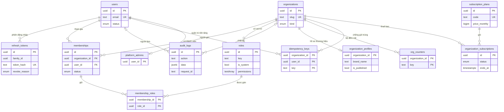
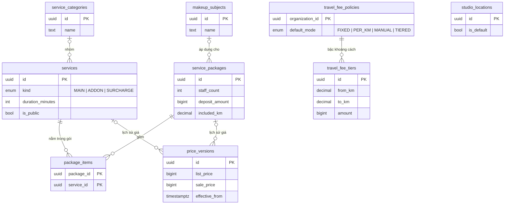
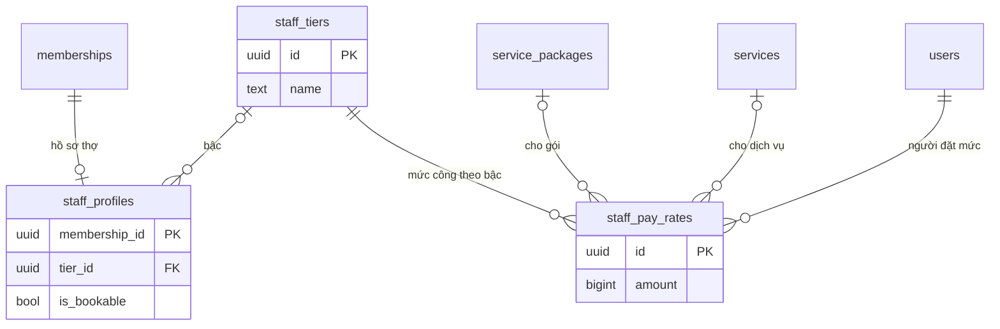
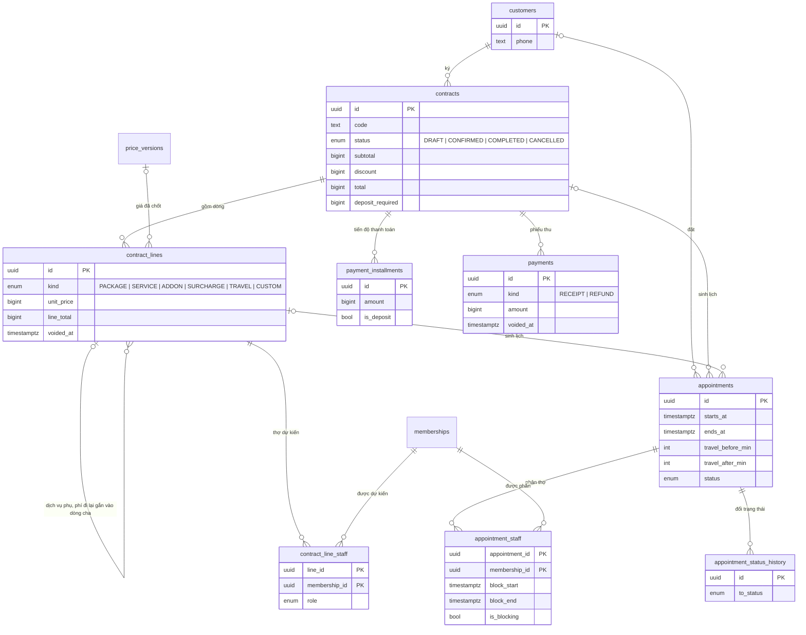
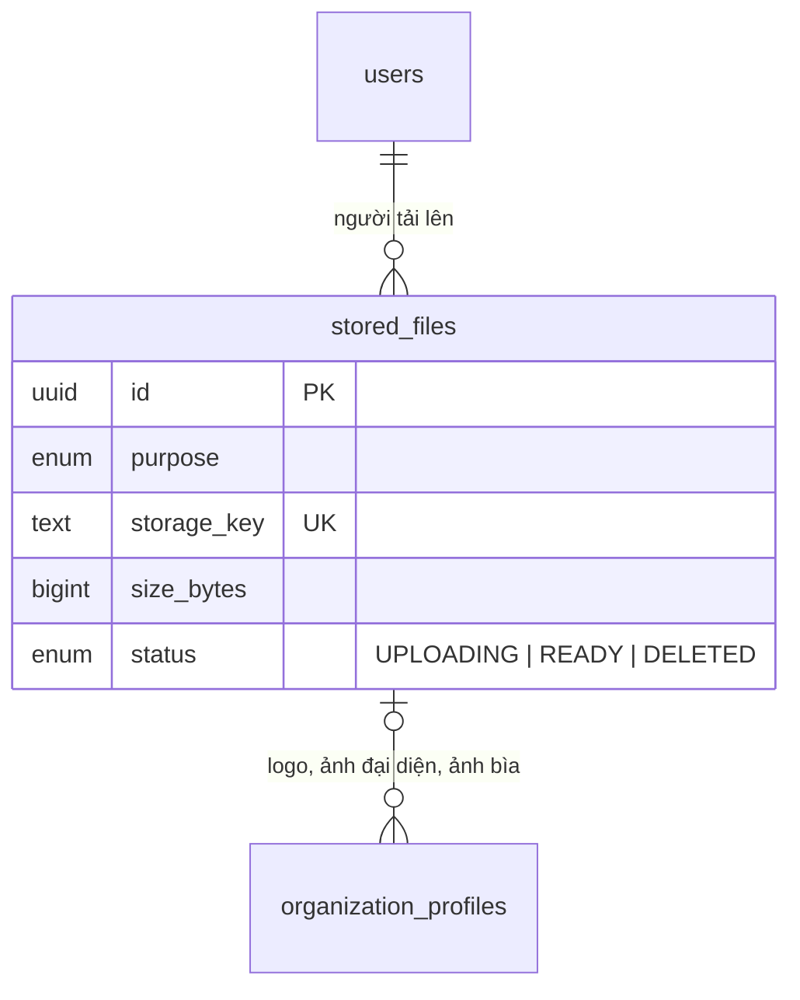
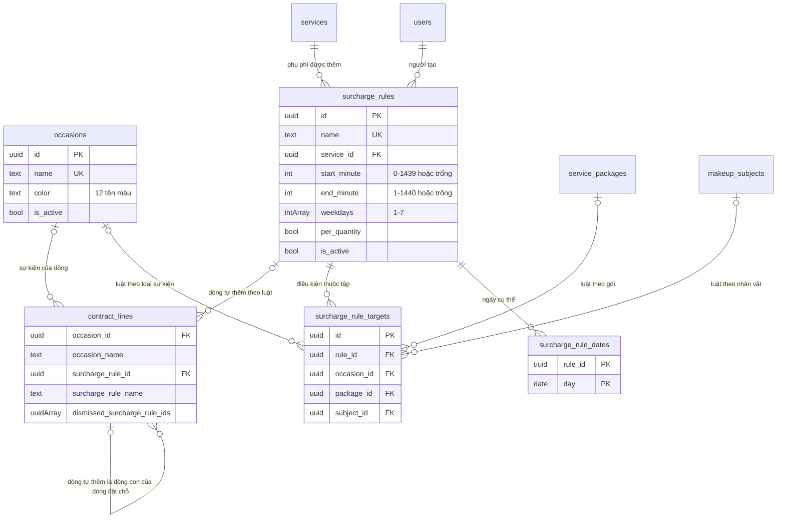

# Cấu trúc dữ liệu — Makeup Pro

Cập nhật: 19/10/2026 (bổ sung mục 6 — bản vẽ D: 4 bảng + 5 cột, migration `20261019130000_hom_nay_su_kien_phu_phi`; các mục 1–5 và mọi số đếm bên dưới vẫn là hiện trạng 18/10, chưa rà lại — các migration ra sau (đào tạo, đặt lại mật khẩu, buổi học lên Lịch, cổng học viên, giấy chứng nhận…) chưa được ghi ở đây; `schema.prisma` ngày 19/10 có 53 `model`). **Mục 1–5 đã đối chiếu với commit `634d6a3`** (17:00 UTC; mã giống hệt `bc9633a`, hai commit sau chỉ thêm sổ ghi). Nguồn: `apps/api/prisma/schema.prisma` (35 `model`) và 9 migration trong `apps/api/prisma/migrations/`.

Đã thử áp cả 9 migration lên một database trống (PostgreSQL 16 trên máy đám mây, ≈17:05 UTC). Đếm bằng truy vấn database: **35 bảng**, 33 CHECK, 2 EXCLUDE, 11 trigger, 3 chỉ mục duy nhất có điều kiện, 4 chỗ xoá dây chuyền.

---

## Phần CỦA NGHỀ — studio nào cũng dùng được

### 1. Vài từ phải biết
| Từ | Nghĩa bằng lời thường |
|---|---|
| Bảng | Một quyển sổ, mỗi dòng là một bản ghi |
| Khoá ngoại | Dòng này "trỏ" sang dòng ở sổ khác; database không cho trỏ tới dòng không có thật |
| Khoá ngoại kép | Trỏ bằng **hai** cột: mã bản ghi + mã tổ chức. Hai bên phải cùng tổ chức mới khớp |
| CHECK | Luật viết thẳng vào database, ví dụ "tiền không âm" |
| Trigger | Lệnh database tự chạy khi có người sửa/xoá; ở đây dùng để **cấm** hoặc **tự tính** |
| EXCLUDE | Luật "hai dòng không được chồng nhau" |
| Kiểm lúc lưu (trì hoãn) | Database đợi đến cuối giao dịch mới kiểm, để máy chủ ghi dòng trước rồi cập nhật tổng sau |
| Xoá dây chuyền | Xoá dòng cha thì database tự xoá dòng con |
| Chỉ mục duy nhất có điều kiện | Luật "không trùng" chỉ áp cho một phần dòng (ví dụ chỉ dòng chưa huỷ). Prisma không viết được loại này nên nó nằm trong migration viết tay |
| Bản chụp | Tên (hoặc giá) được chép vào dòng lúc lưu; đổi ở nguồn sau đó không làm đổi dòng đã lưu |
| Cột mảng | Một ô giữ nhiều giá trị (ví dụ danh sách mã). Database không đặt khoá ngoại được cho từng phần tử, nên máy chủ phải kiểm từng mã |

### 2. Luật dữ liệu cho phần mềm nhiều tổ chức
| # | Luật | Vì sao |
|---|---|---|
| 1 | Mọi bảng nghiệp vụ có mã tổ chức | Lọc theo tổ chức ở mọi câu hỏi |
| 2 | Liên kết giữa hai bảng nghiệp vụ dùng khoá ngoại kép | Database tự chặn gắn chéo tổ chức |
| 3 | Tiền lưu số nguyên đồng | Số thực lệch vài đồng sau nhiều lần cộng trừ |
| 4 | Sổ lịch sử và sổ tiền chỉ ghi thêm | Sửa được thì sổ mất giá trị bằng chứng |
| 5 | Giá chốt vào đơn lúc chốt với khách | Đổi bảng giá không làm đổi đơn đã ký |
| 6 | Số do database tự tính được thì để database tính | Mã máy chủ quên tính lại là lọt lỗi |
| 7 | Trùng lịch chặn ở database | Hai người bấm lưu cùng giây vẫn chỉ một lịch lọt |
| 8 | Không xoá dây chuyền sổ sách | Xoá nhầm một khách không kéo theo hợp đồng của khách |

---

## Phần CỦA RIÊNG DỰ ÁN NÀY

### 1. Danh sách 35 bảng
Ngoài ra có `_prisma_migrations` do Prisma tự quản.

| Nhóm | Bảng | Giữ gì |
|---|---|---|
| Tài khoản | `users` | Tài khoản: email (luôn chữ thường), mật khẩu đã băm, họ tên |
| | `refresh_tokens` | Thẻ dài hạn: chỉ giữ bản băm, "họ" thẻ, hạn, lúc và **lý do** thu hồi (xoay vòng / đăng xuất / phát hiện dùng lại) |
| Tổ chức | `organizations` | Studio / thợ cá nhân / trung tâm: tên, slug, loại, múi giờ, tiền tệ |
| | `memberships` | Một người thuộc một tổ chức: hoạt động / tạm khoá / đã rời |
| | `roles` | Vai trò của từng tổ chức; cột `permissions` là mảng khoá quyền |
| | `membership_roles` | Ai giữ vai trò nào |
| | `audit_logs` | Nhật ký: ai, làm gì, bản ghi nào, mã số yêu cầu |
| | `organization_profiles` | Hồ sơ thương hiệu cho website (tên thương hiệu, giới thiệu, mạng xã hội, giờ làm, chính sách, logo/ảnh); chỉ hiện khi đã xuất bản |
| Bảng giá | `service_categories` | Nhóm dịch vụ |
| | `services` | Dịch vụ: loại chính / phụ / phụ phí, mã, tên, thời lượng, công khai hay không |
| | `service_packages` | Gói: thời lượng, số thợ, cọc mặc định, nhân vật, địa điểm cho phép, bán kính miễn phí |
| | `package_items` | Gói gồm dịch vụ nào |
| | `price_versions` | Lịch sử giá của dịch vụ hoặc gói |
| | `makeup_subjects` | Nhân vật makeup (cô dâu, mẹ cô dâu, phù dâu…) |
| | `studio_locations` | Studio/cửa hàng, điểm xuất phát tính km; tối đa một nơi mặc định |
| | `travel_fee_policies` | Cách tính phí di chuyển mặc định: cố định / theo km / nhập tay / theo bậc |
| | `travel_fee_tiers` | Bậc phí theo khoảng cách một chiều (ví dụ 10–20 km: 200.000 ₫) |
| Nhân sự | `staff_tiers` | Bậc lương do tổ chức đặt |
| | `staff_profiles` | Hồ sơ thợ (1–1 với thành viên): tên hiển thị, ảnh, số điện thoại, bậc, có nhận lịch không |
| | `staff_pay_rates` | Tiền công cho một gói hoặc một dịch vụ, theo từng bậc |
| Khách & hợp đồng | `customers` | Khách: họ tên, số điện thoại, email |
| | `contracts` | Hợp đồng: **nơi duy nhất giữ tiền** của một đơn (tạm tính, giảm giá, tổng, cọc) |
| | `contract_lines` | Dòng hợp đồng: gói / dịch vụ / dịch vụ phụ / phụ phí / di chuyển / tự nhập; giá chốt |
| | `contract_line_staff` | Thợ dự kiến của từng dòng (tối đa một thợ chính) |
| Lịch | `appointments` | Lịch: giờ, phút di chuyển, địa chỉ, trạng thái thực hiện, trỏ về hợp đồng/dòng |
| | `appointment_staff` | Thợ trên lịch (chính/phụ) và khoảng bận do database tự tính |
| | `appointment_status_history` | Lịch sử đổi trạng thái lịch |
| Thu tiền | `payment_installments` | Tiến độ thanh toán: các đợt dự kiến (cọc, đợt 1…) |
| | `payments` | Phiếu thu / phiếu hoàn, chỉ ghi thêm |
| Tệp | `stored_files` | Thông tin tệp (khoá lưu trữ, loại, cỡ, mục đích); tệp nằm ở kho lưu trữ, không nằm trong database |
| Nền tảng | `platform_admins` | Người quản trị toàn nền tảng |
| | `subscription_plans` | Gói thuê bao và hạn mức |
| | `organization_subscriptions` | Lịch sử thuê bao của từng tổ chức; hết hạn không xoá dữ liệu |
| Hệ thống | `org_counters` | Bộ đếm sinh mã tuần tự (LH-000001, HD-000001) |
| | `idempotency_keys` | Khoá chống gửi trùng và kết quả lần đầu |

### 2. Sơ đồ quan hệ
Ký hiệu: `||` đúng một, `o|` không hoặc một, `o{` không hoặc nhiều. Mọi bảng nghiệp vụ còn có khoá ngoại tới `organizations`; sơ đồ 2b–2e không vẽ các đường đó cho đỡ rối.

**2a. Tài khoản, tổ chức, nền tảng, hệ thống (13 bảng)**

**2b. Bảng giá (9 bảng)**

`studio_locations` không trỏ bảng nào trong nhóm này; nó chỉ trỏ về `organizations` và được `contract_lines` trỏ tới.

**2c. Nhân sự & tiền công (3 bảng + liên kết)**

**2d. Khách, hợp đồng, lịch, thu tiền (9 bảng)**

**2e. Tệp (1 bảng)**

Ngoài ra `users` còn là "người tạo" của `price_versions`, `contracts`, `contract_lines`, `appointments`, `appointment_status_history`, `payments` (khoá ngoại thường).

### 3. Giải thích các quan hệ quan trọng

**3.1. Khoá ngoại kép chặn gắn chéo tổ chức ngay trong database.** Mỗi bảng nghiệp vụ có chỉ mục duy nhất `(id, organization_id)` (ví dụ `schema.prisma:150` cho `roles`); bảng con trỏ sang bằng cả hai cột (ví dụ `membership_roles`, `schema.prisma:181-182`). Gán vai trò của tổ chức B cho người ở tổ chức A → database từ chối. Bằng chứng: `apps/api/test/escalation.test.ts`, ca "không gán được vai trò của tổ chức khác, kể cả ghi thẳng vào database". Cùng kiểu cho mọi liên kết bảng giá, hợp đồng, lịch, nhân sự, thu tiền, hồ sơ thương hiệu ↔ ảnh. Thêm một khoá kép đặc biệt: lịch trỏ dòng hợp đồng bằng (dòng, hợp đồng), nên dòng phải thuộc **chính** hợp đồng của lịch (`schema.prisma:424`; CHECK `appointments_line_needs_contract`).

**3.2. Tiền là số nguyên đồng (BigInt)** ở mọi cột tiền: cọc gói, giá, tiền hợp đồng và dòng, phí di chuyển, bậc phí, tiền công, đợt thanh toán, phiếu thu, giá gói thuê bao. Số km là số thập phân 2 chữ số, không phải tiền.

**3.3. Lịch sử giá chỉ ghi thêm.** Trigger `price_versions_append_only` (migration `20261018151403_bang_gia_lich:333-339`). Giá hiện hành = bản có ngày hiệu lực mới nhất không muộn hơn lúc hỏi; công thức duy nhất ở `apps/api/src/modules/catalog/prices.ts:54` và `:73`.

**3.4. Giá chốt vào dòng hợp đồng.** Lúc thêm dòng, đơn giá và bản giá (`price_version_id`, nay có khoá ngoại kép) được ghi vào `contract_lines`. Lịch không giữ tiền. Từ migration 2 sang 3, giá chốt chuyển từ "dòng lịch" sang "dòng hợp đồng" (quyết định 15:20). Sau khi hợp đồng **xác nhận**, database khoá:
- Dòng: không xoá; chỉ được đặt "đã huỷ + lý do", một lần (`20261018160000_chot_chan_database:99-119`).
- Hợp đồng: không về nháp; hợp đồng đã xong/đã huỷ không đổi gì; khách, ngày, điều khoản không đổi; giảm giá và cọc chỉ được hạ (`20261018170000_khoa_tien_hop_dong:6-31`).
- Tổng: tạm tính phải bằng tổng các dòng chưa huỷ, kiểm lúc lưu (`20261018170000_khoa_tien_hop_dong:35-59`).
- Thợ dự kiến: không sửa nữa, đổi thợ ở màn Lịch; trừ dòng phát sinh sau xác nhận (`20261018180000_tho_du_kien_hop_dong:30-44`).

**3.5. Chặn trùng lịch theo khoảng bận, gồm thời gian di chuyển.**
- Khoảng bận = giờ bắt đầu − phút đi trước → giờ kết thúc + phút đi sau. **Database tự tính** khi phân thợ và tự tính lại khi lịch đổi giờ, phút di chuyển hay trạng thái (`20261018160000_chot_chan_database:53-88`). Số khoảng bận máy chủ gửi lên bị bỏ qua.
- Trạng thái chiếm giờ: mọi trạng thái trừ nháp, đã huỷ, khách không đến (hàm `appointment_is_blocking`, dòng 56-58; bài thử so khớp với `isBlockingStatus` của mã dùng chung).
- EXCLUDE `appointment_staff_no_overlap` (`20261018151403_bang_gia_lich:359-361`): cùng một tư cách thành viên, hai khoảng đang chiếm giờ không chồng nhau. Khoảng nửa mở: 10:00 kết thúc và 10:00 bắt đầu không tính là trùng.
- Trùng → máy chủ trả 409 "Trùng lịch" (`apps/api/src/http/middleware.ts:155-156`).
- **Còn hở:** chặn theo tư cách thành viên trong **một** tổ chức. Thợ làm cho hai studio có hai tư cách → hai studio vẫn đặt trùng giờ được cùng một người.
- Thợ dự kiến ở hợp đồng **nháp** không chiếm giờ; chỉ hiện cảnh báo.

**3.6. Trạng thái thực hiện tách khỏi thanh toán.** `WorkStatus` (`schema.prisma:377-386`) chỉ có các bước làm việc. Tiền đã thu nằm ở `payments`, đợt phải thu ở `payment_installments`. Chưa có đường API cho hai bảng này.

**3.7. Sổ chỉ ghi thêm** (trigger cấm sửa/xoá): `audit_logs` (`20261018150452_nen_mong:179-186`), `price_versions`, `appointment_status_history` (`20261018160000_chot_chan_database:90-97`), `payments` — chỉ được huỷ phiếu một lần có lý do (`20261018190000_tep_thu_tien_nen_tang:206-220`).

**3.8. Không xoá dây chuyền.** Mọi khoá ngoại là "cấm xoá cha khi còn con", **trừ 4 chỗ**:

| Xoá dòng này | Database tự xoá theo |
|---|---|
| `memberships` | `membership_roles` của thành viên đó |
| `service_packages` | `package_items` của gói đó |
| `travel_fee_policies` | `travel_fee_tiers` của tổ chức đó |
| `contract_lines` | `contract_line_staff` của dòng đó (dòng của hợp đồng đã xác nhận thì không xoá được) |

Lịch có lịch sử trạng thái thì không xoá được (trước migration 5, xoá lịch kéo theo lịch sử; nay đã chặn). Bằng chứng: `escalation.test.ts` ca "không xoá được tổ chức còn dữ liệu"; `db-guards.test.ts` ca "lịch sử trạng thái không sửa, không xoá được; lịch có lịch sử không xoá được".

### 4. Toàn bộ chốt chặn viết tay
**CHECK (33):**

| Bảng | Tên | Luật | Migration : dòng |
|---|---|---|---|
| users | `users_email_lowercase` | Email viết thường | `nen_mong:172` |
| organizations | `organizations_slug_format` | Slug 3–48 ký tự, chữ thường, số, gạch ngang | `nen_mong:175-176` |
| services | `services_duration_positive` | Thời lượng 1–1440 phút | `bang_gia_lich:320` |
| service_packages | `packages_duration_positive`, `packages_staff_count_positive`, `packages_deposit_non_negative` | Thời lượng 1–1440; số thợ ≥ 1; cọc ≥ 0 | `bang_gia_lich:321-323` |
| service_packages | `packages_included_km` | Bán kính miễn phí ≥ 0 | `tep_thu_tien_nen_tang:200` |
| package_items | `package_items_quantity_positive` | Số lượng ≥ 1 | `bang_gia_lich:324` |
| price_versions | `price_versions_one_owner`, `price_versions_amounts` | Đúng một chủ (dịch vụ hoặc gói); giá ≥ 0; giá khuyến mại ≤ niêm yết | `bang_gia_lich:327-330` |
| appointments | `appointments_time_order`, `appointments_travel_range` | Kết thúc sau bắt đầu; phút di chuyển 0–600 | `bang_gia_lich:342-344` |
| appointments | `appointments_line_needs_contract` | Có dòng hợp đồng thì phải có hợp đồng | `chot_chan_database:50-51` |
| appointment_staff | `appointment_staff_block_order` | Khoảng bận: kết thúc sau bắt đầu | `bang_gia_lich:354` |
| travel_fee_policies | `travel_policy_amounts` | Các mức tiền, km miễn phí ≥ 0 | `hop_dong_nhan_vat:234-235` |
| travel_fee_tiers | `travel_tiers_numbers` | Từ km ≥ 0; đến km > từ km; tiền ≥ 0 | `tep_thu_tien_nen_tang:228-229` |
| contracts | `contracts_money`, `contracts_cancel_reason` | Tiền ≥ 0; tổng = tạm tính − giảm giá; cọc ≤ tổng; huỷ phải có lý do | `hop_dong_nhan_vat:237-241` |
| contract_lines | `contract_lines_money`, `_one_ref`, `_kind_ref`, `_travel_fields`, `_void_reason`, `_schedule_order` | Thành tiền = đơn giá × số lượng − giảm giá ≥ 0; loại dòng khớp thứ được trỏ; chỉ dòng di chuyển có số km; huỷ phải có lý do; giờ hợp lệ | `hop_dong_nhan_vat:243-258` |
| staff_pay_rates | `staff_pay_rates_one_owner`, `staff_pay_rates_amount` | Đúng một chủ (gói hoặc dịch vụ); tiền ≥ 0 | `nhan_su_bac_luong:93-95` |
| refresh_tokens | `refresh_tokens_reason_when_revoked` | Đã thu hồi thì phải có lý do | `nhan_su_bac_luong:99-100` |
| stored_files | `stored_files_size` | Cỡ ≥ 0 | `tep_thu_tien_nen_tang:199` |
| payment_installments | `installments_amount` | Tiền > 0 | `tep_thu_tien_nen_tang:202` |
| payments | `payments_amount`, `payments_void_reason` | Tiền > 0; huỷ phải có lý do | `tep_thu_tien_nen_tang:203-204` |
| subscription_plans | `plans_numbers` | Giá, hạn mức hợp lệ | `tep_thu_tien_nen_tang:222` |
| organization_subscriptions | `subscriptions_period` | Kết thúc sau bắt đầu | `tep_thu_tien_nen_tang:225` |

**EXCLUDE (2):** `appointment_staff_no_overlap` (`bang_gia_lich:358-361`); `travel_tiers_no_overlap` — các bậc phí cùng tổ chức không chồng khoảng km (`tep_thu_tien_nen_tang:230-231`). Cả hai cần extension `btree_gist`.

**Trigger (11):**

| Bảng | Trigger | Việc | Migration : dòng |
|---|---|---|---|
| audit_logs | `audit_logs_no_update` | Cấm sửa, xoá | `nen_mong:179-186` |
| price_versions | `price_versions_append_only` | Cấm sửa, xoá | `bang_gia_lich:333-339` |
| appointment_staff | `appointment_staff_block` | Tự tính khoảng bận, trạng thái chiếm giờ | `chot_chan_database:60-76` |
| appointments | `appointments_staff_block_sync` | Lịch đổi giờ/trạng thái → tính lại khoảng bận | `chot_chan_database:78-88` |
| appointment_status_history | `appointment_status_history_append_only` | Cấm sửa, xoá | `chot_chan_database:90-97` |
| contract_lines | `contract_lines_locked` | Hợp đồng đã xác nhận: dòng chỉ được huỷ | `chot_chan_database:99-119` |
| contracts | `contracts_locked` | Khoá hợp đồng đã xác nhận | `khoa_tien_hop_dong:6-31` |
| contracts, contract_lines | `contracts_totals_check`, `contract_lines_totals_check` | Tổng khớp các dòng, kiểm lúc lưu | `khoa_tien_hop_dong:35-59` |
| contract_line_staff | `contract_line_staff_locked` | Khoá thợ dự kiến sau xác nhận | `tho_du_kien_hop_dong:30-44` |
| payments | `payments_locked` | Chỉ ghi thêm, huỷ một lần | `tep_thu_tien_nen_tang:206-220` |

**Chỉ mục duy nhất có điều kiện (3):** `studio_locations_one_default` (một studio mặc định, `hop_dong_nhan_vat:261`); `contract_line_staff_one_primary` (một thợ chính mỗi dòng, `tho_du_kien_hop_dong:26`); điều kiện `WHERE is_blocking` của EXCLUDE chặn trùng.

**Luật CHƯA có ở database:**

| Luật | Hiện trạng |
|---|---|
| Số điện thoại khách đúng dạng 0xxxxxxxxx | Chỉ máy chủ chuẩn hoá |
| Tổng phiếu thu không vượt tổng hợp đồng; tổng các đợt bằng tổng hợp đồng | Không kiểm (chưa có đường API thu tiền) |
| `platform_admins.created_by_id`, `organization_subscriptions.created_by_id` trỏ tới người có thật | Không có khoá ngoại |
| Dọn khoá chống gửi trùng cũ, tệp ở trạng thái "đang tải" bị bỏ dở | Chưa có |
| Chặn trùng lịch của một người giữa hai tổ chức | Chưa có (mục 3.5) |
| Toạ độ trong khoảng hợp lệ | Không kiểm |

### 5. Bảng DỰ KIẾN cho module sau
> **DỰ KIẾN** — chưa thiết kế, chưa có migration.

| Module | Bảng dự kiến |
|---|---|
| Đào tạo | Khoá học, nhóm khoá, lớp, học viên ghi danh, điểm danh, nội quy, mẫu thiệp chào mừng (R&D vòng 3 đang vẽ) |
| Thông báo | Thông báo, cài đặt nhận, mã thiết bị nhận push |
| Tiền công đã trả | Bảng chi trả chụp lại số tiền lúc trả (ghi chú trên `StaffPayRate` trong `schema.prisma`) |

### 6. Bản vẽ D (19/10/2026): loại sự kiện, luật phụ phí, phụ phí tự động — 4 bảng mới + 5 cột
Nguồn: `apps/api/prisma/migrations/20261019130000_hom_nay_su_kien_phu_phi/migration.sql` (155 dòng, một tệp, chạy trong một giao dịch: lỗi thì không áp dở) và `apps/api/prisma/schema.prisma` (`Occasion` `:616`, `SurchargeRule` `:638`, `SurchargeRuleTarget` `:672`, `SurchargeRuleDate` `:693`, thêm trường vào `ContractLine` `:853`). Bản vẽ: `docs/rnd/BAN-VE-D-HOM-NAY-SU-KIEN-PHU-PHI.md` mục 1; SQL của migration giống từng chữ SQL ở mục 1.4 của bản vẽ (so bằng `diff`), nên **không có chỗ khác bản vẽ** ở tầng database. Cách máy chủ dùng các bảng này: `API_SPEC.md` mục 9.

**Từ dùng ở mục này** (ngoài bảng từ ở phần chung): *dòng đặt chỗ* = dòng hợp đồng loại `PACKAGE`/`SERVICE` (có giờ, nơi làm, thợ); *dòng tự thêm* = dòng `SURCHARGE` do luật sinh ra, là dòng con của một dòng đặt chỗ; *luật* = quy tắc phụ phí studio cài.

#### 6.1 Bảng mới và cột mới
| Nhóm | Bảng | Giữ gì |
|---|---|---|
| Bảng giá | `occasions` | Loại sự kiện studio tự đặt: tên (1–60 ký tự), màu (một trong 12 tên màu của Lịch), thứ tự, ẩn/hiện. Không xoá, chỉ ẩn |
| | `surcharge_rules` | Luật phụ phí: tên, phụ phí (dịch vụ) được thêm, khung giờ bắt đầu (phút từ 0:00), thứ trong tuần, tính theo số lượng hay không, ghi chú, thứ tự ưu tiên, bật/tắt, người tạo. Không xoá, chỉ tắt |
| | `surcharge_rule_targets` | Điều kiện "thuộc tập" của luật: mỗi dòng là **đúng một** loại sự kiện **hoặc** một gói **hoặc** một nhân vật. Dùng khoá ngoại thật thay cho mảng mã |
| | `surcharge_rule_dates` | Ngày cụ thể / ngày lễ của luật (ngày theo lịch, không giờ) |
| Khách & hợp đồng | `contract_lines` (thêm 5 cột) | `occasion_id` + `occasion_name` (sự kiện của dòng và bản chụp tên); `surcharge_rule_id` + `surcharge_rule_name` (dòng này do luật nào tự thêm và bản chụp tên luật; trống = dòng nhập tay); `dismissed_surcharge_rule_ids` (mảng mã luật người lập đã bỏ ở dòng đặt chỗ này, mặc định rỗng) |

Ngoài ra thêm 3 chỉ mục thường cho trang Hôm nay đọc nhanh: `payment_installments(organization_id, due_date)`, `contracts(organization_id, confirmed_at)`, `enrollments(organization_id, enrolled_at)` (`migration.sql:153-155`). **Không** thêm quyền, enum hay trigger; không đổi bảng `appointments` (màu ca đọc qua dòng hợp đồng).

#### 6.2 Sơ đồ quan hệ (2f)

Mọi bảng mới còn có khoá ngoại thường tới `organizations` (không vẽ cho đỡ rối).

#### 6.3 Giải thích
- **Khoá ngoại kép ở mọi liên kết nghiệp vụ** (luật số 2 ở phần chung): `surcharge_rules(service_id, organization_id) → services`; `surcharge_rule_targets` trỏ luật, loại sự kiện, gói, nhân vật đều bằng cặp (mã, mã tổ chức); `surcharge_rule_dates` trỏ luật bằng cặp; `contract_lines(occasion_id, organization_id) → occasions` và `contract_lines(surcharge_rule_id, organization_id) → surcharge_rules`. Mỗi bảng đích có chỉ mục duy nhất `(id, organization_id)` (`migration.sql:18`, `:46`). Hậu quả: luật của studio A không trỏ được dịch vụ / gói / nhân vật / loại sự kiện của studio B, dòng hợp đồng của A không trỏ được sự kiện hay luật của B — **database tự từ chối**. Chỉ `surcharge_rules.created_by_id → users` là khoá thường (người dùng không thuộc một tổ chức).
- **Ngoại lệ có chủ đích: mảng `dismissed_surcharge_rule_ids` không có khoá ngoại** (database không đặt khoá ngoại cho từng phần tử của mảng). Vì vậy máy chủ phải kiểm từng mã là luật **của tổ chức** (`autoSurcharge.ts`, hàm `checkLineRuleRefs`, mã lạ → 404 "Không tìm thấy luật phụ phí") — đó là chốt duy nhất, và cửa gác có đột biến D2 canh đúng chỗ này (`API_SPEC.md` mục 9.8). Đây là lý do điều kiện của luật dùng bảng con `surcharge_rule_targets` thay vì mảng mã.
- **Bản chụp**: `occasion_name`, `surcharge_rule_name` được chép vào dòng lúc lưu; đổi tên loại / luật sau đó không đổi hợp đồng. Màu thì không chụp: Lịch đọc màu **hiện tại** của loại.
- **Hợp đồng đã xác nhận khoá cả 5 cột mới mà không phải sửa trigger**: `contract_lines_locked` (hàm `contract_lines_lock_after_confirm`, `20261018160000_chot_chan_database:99-119`) so toàn bộ dòng cũ và mới ngoại trừ hai cột huỷ dòng (`to_jsonb(NEW) − 'voided_at' − 'void_reason'` so với `to_jsonb(OLD)` cùng cách trừ), nên cột nào thêm vào `contract_lines` cũng tự nằm trong diện "dòng đã chốt không được sửa — chỉ huỷ dòng có lý do hoặc thêm dòng phát sinh". Có bài thử riêng (`hom-nay-su-kien-phu-phi-db.test.ts`, ca "hợp đồng đã xác nhận: 5 cột mới nằm trong diện khoá dòng").
- **Luật không đọc được bằng CHECK** (CHECK không nhìn sang bảng khác) nên do máy chủ giữ: phụ phí của luật phải là dịch vụ loại `SURCHARGE` (loại dịch vụ còn đổi được về sau — máy chủ chặn lúc lưu luật và **bỏ qua** luật lúc tính nếu dịch vụ đã đổi loại hoặc ngừng); luật phải có ít nhất một điều kiện giờ / ngày / sự kiện (điều kiện nằm ở hai bảng con); trần 50 luật đang bật và 50 loại sự kiện mỗi tổ chức.
- **Không xoá dây chuyền sổ sách (luật 8) vẫn đúng, thêm 2 chỗ xoá dây chuyền** ngoài bốn chỗ ở mục 3.8: xoá `surcharge_rules` thì `surcharge_rule_targets` và `surcharge_rule_dates` của luật đó tự xoá theo (`migration.sql:92`, `:109`). Đây chỉ là điều kiện của luật, không phải sổ tiền; vả lại luật đã sinh dòng hợp đồng thì **không xoá được** (`contract_lines` → luật là `ON DELETE RESTRICT`), và API không có đường xoá luật. Loại sự kiện đang được dòng hợp đồng hoặc luật dùng cũng không xoá được.

#### 6.4 Chốt chặn viết tay của migration
**CHECK (12 mới):**

| Bảng | Tên | Luật | Migration : dòng |
|---|---|---|---|
| occasions | `occasions_name` | Tên 1–60 ký tự, không thừa khoảng trắng hai đầu | `:21` |
| occasions | `occasions_color` | Màu thuộc đúng 12 tên: rose, violet, amber, green, blue, taupe, brick, petrol, olive, plum, forest, brown | `:23-24` |
| occasions | `occasions_sort_order` | Thứ tự ≥ 0 | `:25` |
| surcharge_rules | `surcharge_rules_name` | Tên 1–120 ký tự, không thừa khoảng trắng hai đầu | `:55` |
| surcharge_rules | `surcharge_rules_window` | Khung giờ: **hoặc** cả hai đầu trống, **hoặc** cả hai có và giờ bắt đầu 0–1439, giờ kết thúc **1–1440**, hai đầu khác nhau. Bắt đầu lớn hơn kết thúc = qua nửa đêm. `1440` (= "24:00") chỉ dùng cho giờ kết thúc — vì thế API chặn `00:00` ở giờ kết thúc và nhận `24:00` | `:57-63` |
| surcharge_rules | `surcharge_rules_weekdays` | Tối đa 7 phần tử, không phần tử trống, mỗi phần tử 1–7 | `:64-68` |
| surcharge_rules | `surcharge_rules_note` | Ghi chú trống hoặc ≤ 500 ký tự | `:69` |
| surcharge_rules | `surcharge_rules_sort_order` | Thứ tự ≥ 0 | `:70` |
| surcharge_rule_targets | `surcharge_rule_targets_one` | **Đúng một** trong ba mã (sự kiện / gói / nhân vật) được điền | `:85-86` |
| contract_lines | `contract_lines_occasion` | Mã sự kiện và tên chụp cùng có hoặc cùng trống; có thì phải là dòng `PACKAGE`/`SERVICE` | `:126-129` |
| contract_lines | `contract_lines_auto_surcharge` | Mã luật và tên luật cùng có hoặc cùng trống; có thì phải là dòng `SURCHARGE` **và** là dòng con (có dòng cha) | `:131-135` |
| contract_lines | `contract_lines_dismissed_rules` | Mảng luật đã bỏ: ≤ 50 phần tử, không phần tử trống, và chỉ dòng `PACKAGE`/`SERVICE` mới được khác rỗng | `:137-141` |

Mọi CHECK có cột cho phép trống đều viết rõ `IS NOT NULL` ở vế còn lại, vì CHECK của PostgreSQL chỉ chặn khi kết quả là **sai**; kết quả "không biết" (do một cột trống) lại lọt qua (sổ lỗi 24). Riêng `surcharge_rule_targets_one` dùng `num_nonnulls`, hàm trả số nguyên nên không dính bẫy này.

**Chỉ mục duy nhất thường:** `occasions(organization_id, name)` — tên loại không trùng trong tổ chức; `surcharge_rules(organization_id, name)` — tên luật không trùng; `surcharge_rule_targets(rule_id, occasion_id)`, `(rule_id, package_id)`, `(rule_id, subject_id)` — một mã chỉ một lần mỗi luật; khoá chính `surcharge_rule_dates(rule_id, day)` — ngày không trùng trong một luật.

**Chỉ mục duy nhất CÓ ĐIỀU KIỆN (mới, thành 4 cái cùng loại với ba cái ở mục 4):** `contract_lines_one_auto_per_rule` trên `(parent_line_id, surcharge_rule_id)` `WHERE surcharge_rule_id IS NOT NULL AND voided_at IS NULL` (`migration.sql:144-146`) — mỗi dòng đặt chỗ có tối đa **một dòng tự thêm chưa huỷ** cho mỗi luật. Huỷ dòng cũ thì cho tự thêm dòng mới; dòng nhập tay (không có luật) không bị tính. Chỉ mục này **không có trong `schema.prisma` như một `@@unique`** (Prisma không ghi được chỉ mục có điều kiện) — chỉ có ghi chú ở model `ContractLine`, nên khi chạy `prisma migrate diff` phải coi đây là chỗ lệch đã biết, giống `appointments_class_session_live_key`.

**Chỉ mục thường mới:** `surcharge_rules(organization_id, is_active, sort_order)`; `contract_lines(occasion_id)`, `contract_lines(surcharge_rule_id)`; ba chỉ mục của trang Hôm nay ở mục 6.1.

**Trigger mới: không có** (xem trên: trigger khoá dòng cũ đã bao 5 cột mới).

#### 6.5 Dữ liệu cũ
Migration **không đổi dòng cũ nào**: chỉ thêm bảng, thêm cột cho phép trống hoặc mảng rỗng, thêm chỉ mục; dòng cũ có cột mới trống / `{}` nên đạt mọi CHECK. Cũng **không chèn dữ liệu**: 6 loại sự kiện mặc định (Ăn hỏi, Lễ vu quy, Lễ cưới, Tiệc, Pre-wedding, Kỷ yếu) do máy chủ cài cho tổ chức mới, và do lệnh `db:sync-roles` bù cho tổ chức cũ **chỉ khi tổ chức chưa có loại nào**.

| Cột | Trống / rỗng nghĩa là |
|---|---|
| `contract_lines.occasion_id`, `occasion_name` | Dòng **chưa chọn sự kiện** — Lịch hiện "Chưa chọn sự kiện"; luật theo loại sự kiện không khớp |
| `contract_lines.surcharge_rule_id`, `surcharge_rule_name` | Dòng **không do luật sinh** (nhập tay, mọi dòng cũ) |
| `contract_lines.dismissed_surcharge_rule_ids` = `{}` | Người lập chưa bỏ luật nào ở dòng này |
| `surcharge_rules.start_minute`, `end_minute` | Luật không xét giờ bắt đầu |
| `surcharge_rules.weekdays` = `{}` **và** không có dòng ở `surcharge_rule_dates` | Luật không xét ngày |
| `surcharge_rules.note` | Không có ghi chú |

Số đếm chốt trước khi nâng cấp (số H1 đo ngày 19/10 trên bản sao dữ liệu thử): 4 bảng mới 0/0 (chưa tồn tại), 5 cột mới 0/0; `contract_lines` có 22 dòng. Sau khi áp: đếm lại 4 bảng = 4, 5 cột = 5, và số dòng `contract_lines` có `occasion_id` hoặc `surcharge_rule_id` khác trống hoặc mảng đã bỏ khác rỗng phải bằng **0** (dữ liệu cũ không bị đổi). Hợp đồng **nháp** cũ là ngoại lệ ở tầng ứng dụng, không phải ở database: lần lưu dòng kế tiếp luật mới có thể tự thêm dòng phụ phí (ký duyệt D câu 6).

#### 6.6 Bài thử và cửa gác
- Bài thử ghi **thẳng vào database** (bỏ qua máy chủ, để thử chính chốt chặn): `apps/api/test/hom-nay-su-kien-phu-phi-db.test.ts` — mỗi CHECK có ca bị chặn và ca ghi được, khoá ngoại kép với dịch vụ / gói / nhân vật / sự kiện / luật của tổ chức khác, chỉ mục có điều kiện (đúng điều kiện `WHERE`), xoá dây chuyền và xoá bị chặn, khoá dòng sau xác nhận.
- Cửa gác cách ly tổ chức (số đo sau gói M7: tổng 888/888, sửa một phần 23/23, đột biến D1–D3 đều đỏ đúng phép) ghi ở `API_SPEC.md` mục 9.8; phần liên quan đến database là phép `crossRef`: thay từng trường `…Id`/`…Ids` mới (`occasionId`, `surchargeOverrides[].ruleId`, `dismissedRuleIds[]`, và các mảng trong thân luật) bằng mã của tổ chức khác thì phải bị từ chối.
