# Báo cáo R&D 06: Cổng học viên tự đăng nhập và App iPhone

- Sản phẩm: Makeup Pro
- Người đọc: anh Chiến (chủ studio ảnh cưới)
- Ngày: 19/10/2026
- Người làm: Trung tâm R&D
- Chặng: **1**. Mỗi đề tài có ba phương án, kèm ảnh thật chụp từ bản mẫu. Theo luật chặng 1, R&D **cố ý không** dựng bản vẽ thông số. Bản vẽ thông số chỉ làm sau khi anh chọn phương án.
- Bản mẫu (mở bằng trình duyệt, không cần mạng):
  - Cổng học viên: /home/user/a/docs/rnd/v6-hoc-vien.html
  - App iPhone: /home/user/a/docs/rnd/v6-iphone.html
  - Phần dùng chung: /home/user/a/docs/rnd/v6-chung/v6.css. Tệp này dùng lại nguyên màu, chữ và thành phần của họ C (`v4-chung/v4.css`, chép đúng `apps/web/src/styles/tokens.css`).
- Ảnh: /home/user/a/docs/rnd/anh-rnd06/. Có 32 ảnh màn hình và 4 ảnh tài nguyên dùng trong bản mẫu, ảnh nặng nhất 199 KB. R&D đã mở xem từng ảnh trước khi nộp.

---

## 0. Kết luận: R&D đề xuất gì và anh cần quyết gì

| Đề tài | R&D đề xuất | Lý do chính | Công sức | Tiền |
|---|---|---|---|---|
| 1. Cổng học viên | **Phương án B**: trung tâm gửi đường dẫn riêng qua Zalo, học viên nhập **4 số cuối số điện thoại** là vào. Mọi thứ nằm trên **một trang cuộn**. | Không tốn đồng nào. Không cần dịch vụ gửi thư hay SMS (máy chủ hiện chưa có). Hợp thói quen nhắn Zalo của trung tâm. Học viên chỉ bấm 2 lần. | khoảng **9 buổi** | 0 đồng |
| 2. App iPhone | **Hướng 1**: web cài lên màn hình chính iPhone (PWA). | Không cần Apple, không mất phí. Dùng nguyên mã web đang có. Từ iOS 16.4 có thông báo đẩy. Cổng học viên cũng dùng được cách này. | khoảng **5 buổi** (có thông báo đẩy) | 0 đồng |

"Buổi" ở đây là **một buổi làm việc của thợ, khoảng 3–4 giờ**.

**Cần anh quyết hoặc cấp:**
1. Chọn cách vào cổng học viên: A, B hay C. R&D đề xuất B.
2. Đồng ý các con số chặn của phương án B: mỗi đường dẫn mở tối đa 2 máy; chưa mở thì hết hạn sau 7 ngày; nhập sai 5 lần thì khoá; mỗi máy được nhớ 90 ngày.
3. Ảnh **Feedback** có hiện cho học viên không? Ảnh chào mừng thì hiển nhiên hiện. Ảnh feedback có thể chứa lời khen anh muốn duyệt trước.
4. Có cho học viên thấy **số tài khoản ngân hàng** để tự chuyển khoản không. Nếu có, anh nhập số tài khoản; máy chủ cần thêm trường mới.
5. App iPhone: chọn hướng 1, 2 hay 3. R&D đề xuất 1.
6. **Tên miền + đưa lên máy thật.** Cổng học viên và thông báo đẩy chỉ thử được trên iPhone thật khi có địa chỉ `https://…`. Hiện chưa có môi trường thật nào (`docs/DEPLOYMENT.md` dòng 5).
7. Chỉ khi chọn hướng 2 hoặc 3: tài khoản Apple Developer 99 USD/năm (đăng ký cá nhân hay công ty), một máy Mac và một trang chính sách quyền riêng tư (xem mục 2.4).
8. Chỉ khi chọn phương án C của cổng học viên: lập Zalo OA đã xác thực và xin duyệt mẫu tin, hoặc đăng ký tên thương hiệu SMS, rồi nạp tiền.

---

## 1. Đề tài 1: Cổng học viên tự đăng nhập

### 1.1 Học viên cần thấy gì (giống nhau ở cả ba phương án)

Ba phương án **cùng đọc một bộ dữ liệu**. Chúng chỉ khác ở **cách vào** và **cách bày**.

| Ô trên màn | Lấy từ dữ liệu nào (`apps/api/prisma/schema.prisma`) | Ghi chú |
|---|---|---|
| Logo và tên trung tâm | `OrganizationProfile.logoFileId`, `brandName` | đã có |
| Tên và ảnh học viên | `Customer.fullName`, `Customer.avatarFileId` | đã có. Lời chào dùng tên gọi (chữ cuối của tên). |
| Khoá, lớp, trạng thái | `Enrollment` (ACTIVE, `customerId` = mình) → `CourseClass.name` → `Course.name`. Trạng thái lấy từ `Enrollment.status`. | đã có |
| Lịch học (thứ, giờ) | `CourseClass.weekdays`, `startMinute`, `endMinute` | đã có |
| Danh sách 12 buổi, "Buổi 4/12", "Hôm nay" | **TÍNH**: máy chủ tính từ `CourseClass.startDate` → `endDate` theo `weekdays`, số buổi lấy từ `Course.sessionCount` | Chỉ là **dự kiến**. Buổi bị dời hoặc huỷ thì cần trường mới `ClassSession`. |
| "Đã qua" | **TÍNH** theo ngày | **Chưa phải điểm danh**. Điểm danh cần trường mới `SessionAttendance`. |
| Giảng viên | `CourseClass.instructorMembershipId` → `StaffProfile.displayName`, `avatarFileId` | **Không** hiện `StaffProfile.phone`, vì đó là số riêng của giảng viên. |
| Địa điểm, nút Chỉ đường | `CourseClass.studioLocationId` → `StudioLocation.name`, `address`, `latitude`, `longitude` | đã có |
| Hợp đồng: mã, ngày ký, học phí, giảm, phải đóng | `Contract.code`, `confirmedAt`, `status`; `ContractLine` (kind COURSE) `.name`, `.unitPrice`; `Contract.discount`, `Contract.total` | Chỉ hiện hợp đồng **đã xác nhận**, không hiện bản nháp. |
| Điều khoản hợp đồng | `Contract.terms` (bản chụp lúc ký) | đã có |
| Các đợt đóng tiền | `PaymentInstallment.name`, `dueDate`, `amount`, `isDeposit`, `sortOrder` | đã có |
| Đã đóng | **TÍNH**: tổng `Payment.amount` loại RECEIPT chưa huỷ (`voidedAt` trống), trừ loại REFUND | đã có |
| Còn lại, thanh tiến độ | **TÍNH**: `Contract.total` − đã đóng | đã có |
| "Đợt 1 còn thiếu 1.000.000 ₫" | **TÍNH**: dồn tiền đã đóng vào các đợt theo thứ tự `sortOrder` | Máy chủ **không ghi** phiếu nào trả cho đợt nào. Muốn chính xác thì cần trường mới `Payment.installmentId` (xem 1.6). |
| Phiếu thu (mã, ngày, cách trả, số tiền) | `Payment.code`, `receivedAt`, `method`, `amount` | đã có |
| Cách chuyển khoản | **MỚI**: `OrganizationProfile.bankName`, `bankAccountNo`, `bankAccountName` | Nội dung chuyển khoản ghép từ `Contract.code` + tên học viên. |
| Nội quy | `Contract.rules` (bản chụp lúc xác nhận), `rulesTemplateVersion` | Sau này trung tâm sửa mẫu thì học viên vẫn thấy đúng bản đã ký. |
| Ảnh chào mừng, ảnh feedback | `DesignCard` (kind WELCOME / FEEDBACK, `customerId` = mình, `deletedAt` trống) → `outputFileId` | **MỚI**: `DesignCard.portalVisible` để trung tâm chọn ảnh nào cho học viên thấy. |
| Gọi hoặc nhắn trung tâm | `OrganizationProfile.phone`, `zalo` | đã có |

**Không bao giờ hiện cho học viên:** tên hay số điện thoại của bạn cùng lớp, `Contract.notes` và `Customer.note` (ghi chú nội bộ), người lập hợp đồng, lý do huỷ phiếu thu.

Muốn xem trường dữ liệu dán ngay trên màn, thêm `?truong` vào đường dẫn bản mẫu. Màu tím là trường đã có. Màu xanh "TÍNH" là máy chủ tự tính. Màu nâu "MỚI" là trường cần thêm. Ảnh mẫu:
- `anh-rnd06/hv-A-trang-chu-truong-390.png`
- `anh-rnd06/hv-B-trang-truong-390.png`
- `anh-rnd06/hv-C-hoc-phi-truong-390.png`

### 1.2 Ba phương án

Thuật ngữ dùng trong mục này:
- **Phiên đăng nhập**: sau khi vào được một lần, máy đó được "nhớ", học viên không phải vào lại mỗi lần mở.
- **OTP**: mã dùng một lần, gửi về điện thoại, thường 6 số, sống vài phút.
- **SMS brandname**: tin nhắn hiện tên trung tâm thay cho số lạ. Phải đăng ký với nhà mạng và trả tiền cho từng tin.
- **ZNS (Zalo Notification Service)**: tin nhắn do Zalo gửi thay doanh nghiệp. Cần **Zalo OA**, tức tài khoản doanh nghiệp trên Zalo đã xác thực, và mẫu tin phải được Zalo duyệt. Trả tiền theo tin.

#### Phương án A: Email + mật khẩu, bố cục "trang chủ nhiều thẻ" và thanh 4 tab dưới đáy

| Trung tâm mời (máy tính) | Đăng nhập | Trang chủ | Tab Học phí | Tab Hồ sơ |
|---|---|---|---|---|
| 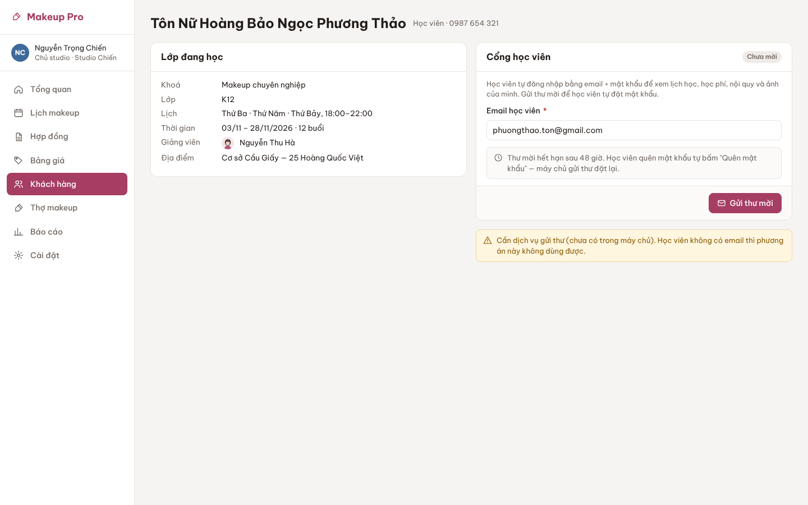 | 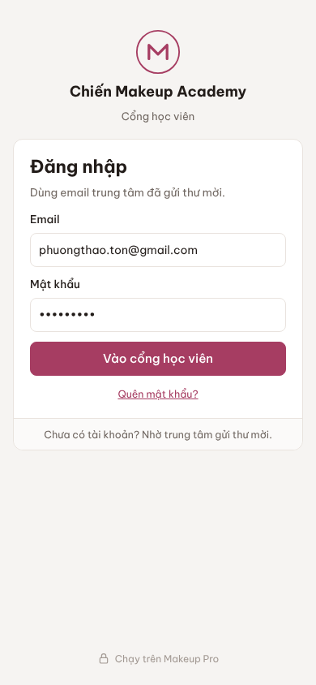 | 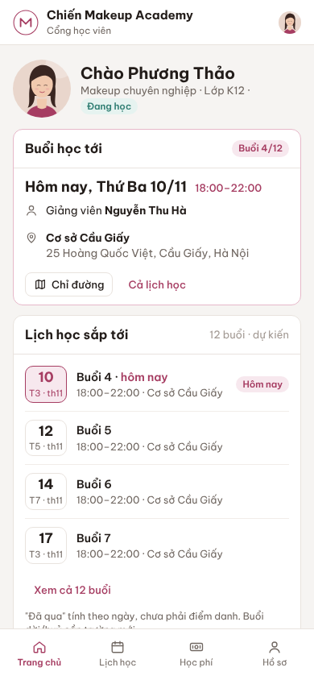 | 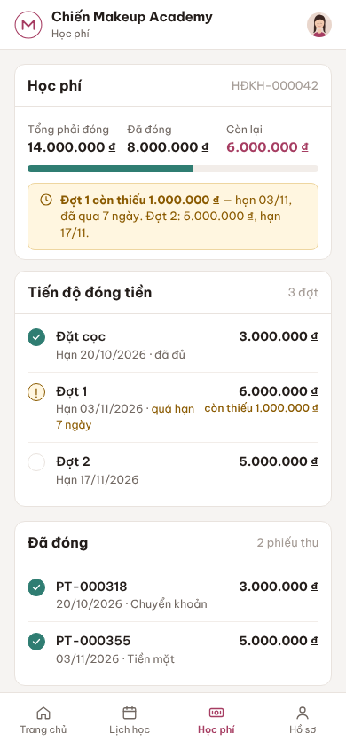 | 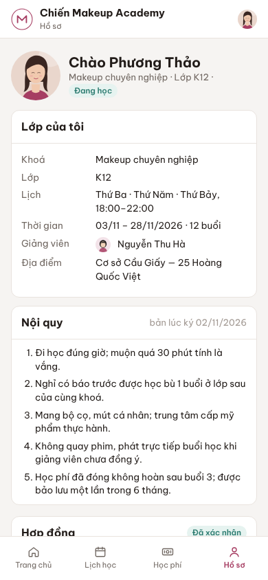 |

Trên máy tính: 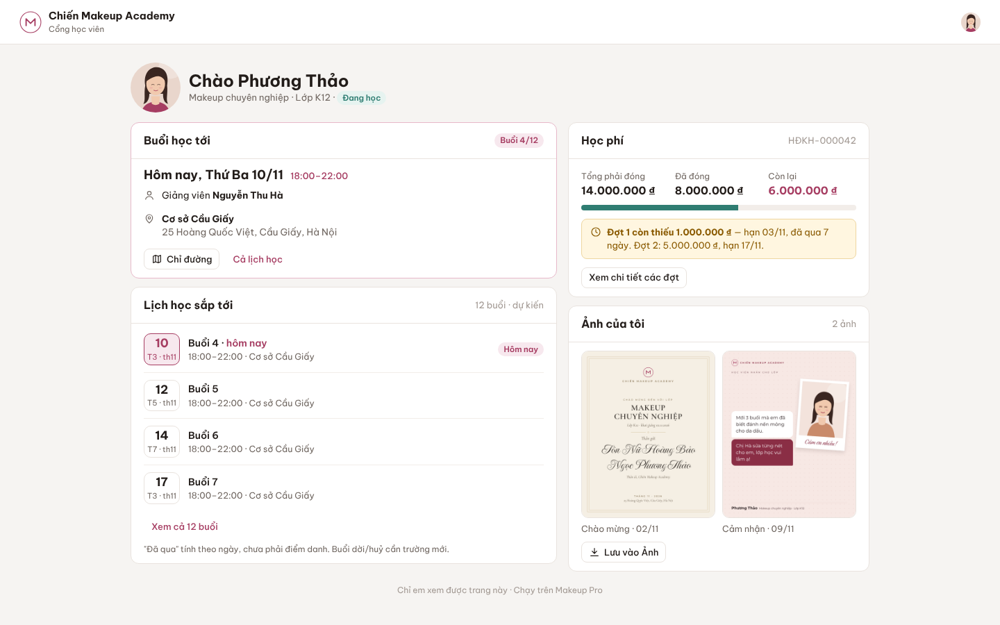

- **Cách vào:** trung tâm nhập email học viên rồi bấm "Gửi thư mời". Học viên mở thư, tự đặt mật khẩu, từ đó đăng nhập bằng email + mật khẩu. Quên mật khẩu thì bấm "Quên mật khẩu?" để nhận thư đặt lại.
- **Bố cục:** Trang chủ có thẻ "Buổi học tới", "Lịch học sắp tới", "Học phí" và "Ảnh của tôi". Ba tab còn lại là Lịch học, Học phí, Hồ sơ (gồm nội quy, hợp đồng, đổi mật khẩu, đăng xuất).
- **Ưu:** quen thuộc, giống web quản trị hiện tại. Không tốn tiền theo tin nhắn.
- **Nhược:**
  - Cần **dịch vụ gửi thư**, mà máy chủ chưa có. Việc "đặt lại mật khẩu qua email" cũng đang nằm trong danh sách chưa làm (`docs/SO-Y-MUON.md` dòng 32).
  - Học viên phải nhớ thêm một mật khẩu.
  - Học viên không dùng email thì không vào được. Đây là suy luận, chưa đo.
  - Học viên nhiều bấm nhất: mở thư, đặt mật khẩu, rồi mới đăng nhập.
- **Công sức: khoảng 10–11 buổi.**
  - Tài khoản cổng, thư mời, đặt và quên mật khẩu, gắn dịch vụ gửi thư: 3
  - Đường đọc dữ liệu "của tôi": 2
  - Giao diện 4 tab: 3
  - Màn mời ở phía trung tâm: 1
  - Bài thử chặn lộ dữ liệu: 1,5
- **Chi phí:** dịch vụ gửi thư. **Chưa kiểm giá**: R&D chưa mở được trang giá của nhà cung cấp nào trong phiên này.

#### Phương án B: Đường dẫn riêng gửi qua Zalo + 4 số cuối điện thoại, bố cục "một trang cuộn"

"Đường dẫn riêng" (trong nghề gọi là *magic link*) là một địa chỉ web có gắn chìa khoá riêng cho một người. Bấm vào là vào, không cần mật khẩu.

| Trung tâm gửi (máy tính) | Trung tâm gửi (điện thoại) | Học viên mở trên máy mới | Nhập sai hoặc bị khoá |
|---|---|---|---|
| 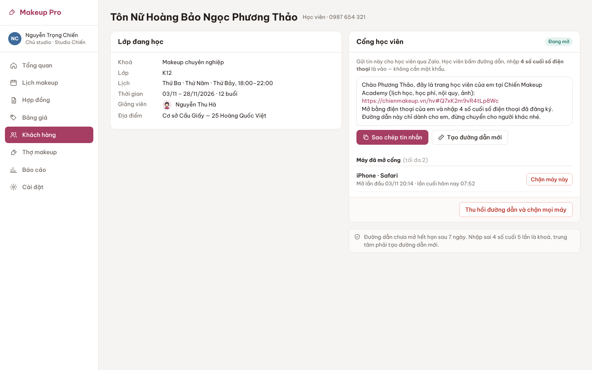 | 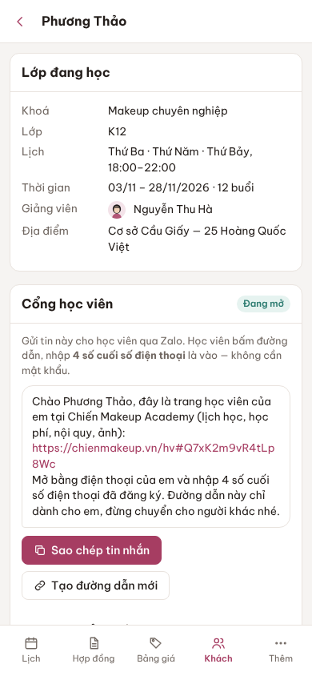 | 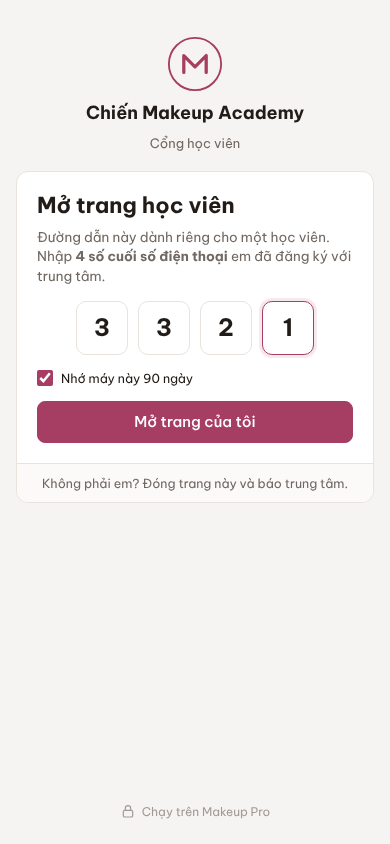 | 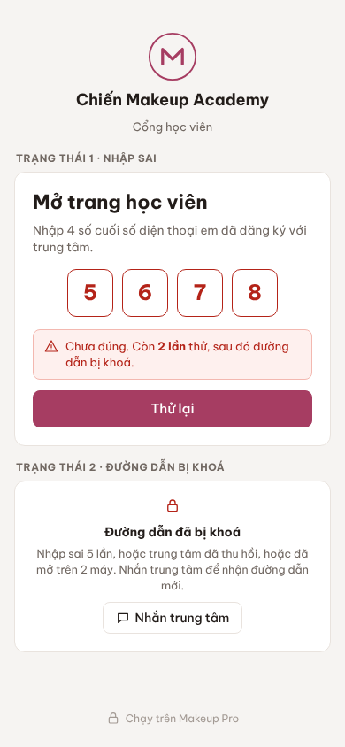 |

| Trang học viên (đầu trang) | Cuộn tới Học phí | Trên máy tính |
|---|---|---|
| 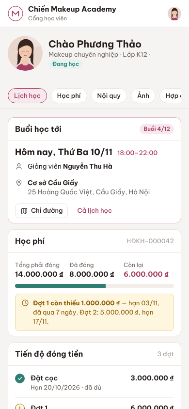 | 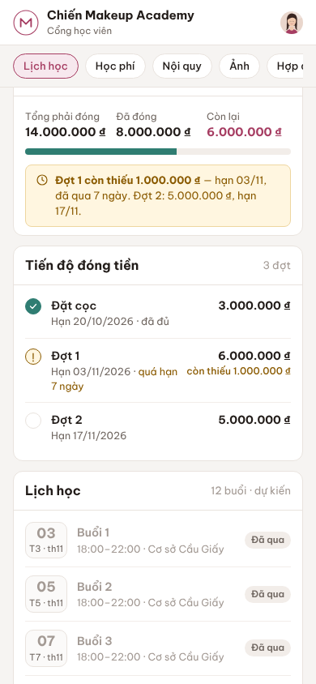 | 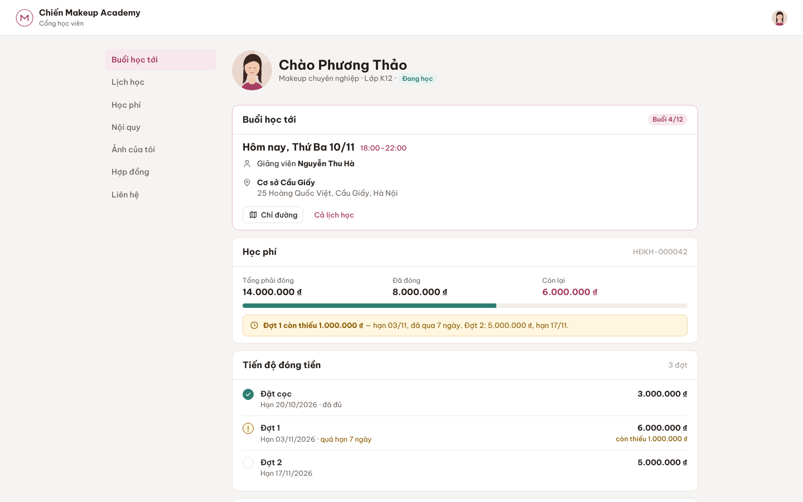 |

- **Cách vào:**
  1. Ở hồ sơ học viên, trung tâm bấm **"Sao chép tin nhắn"**. Tin đã soạn sẵn, có đường dẫn và lời dặn "đừng chuyển cho người khác".
  2. Trung tâm dán tin vào Zalo của học viên.
  3. Học viên bấm đường dẫn, nhập 4 số cuối số điện thoại, bấm "Mở trang của tôi". Máy đó được nhớ 90 ngày.
- **Bố cục:** **một trang**, cuộn từ trên xuống: Buổi học tới, Học phí, Tiến độ đóng tiền, Lịch 12 buổi, Nội quy, Ảnh, Hợp đồng, Liên hệ. Hàng chip trên đầu (điện thoại) hoặc cột trái (máy tính) giúp nhảy nhanh tới từng mục.
- **Ưu:**
  - 0 đồng. Không cần dịch vụ gửi thư hay SMS. Zalo chỉ là nơi trung tâm **tự dán** tin, máy chủ không cần nối với Zalo.
  - Học viên bấm ít nhất (đường dẫn, rồi 4 số).
  - Trung tâm nhìn thấy học viên đã mở trên máy nào và thu hồi được.
  - Học viên vào xem vài lần mỗi tháng, nên một trang cuộn dễ hơn phải học cách dùng tab. Đây là suy luận.
- **Nhược:**
  - Kém chặt hơn OTP: ai có **cả** đường dẫn **lẫn** 4 số cuối thì vào được, cho tới khi hết 2 suất máy.
  - Trung tâm phải tự dán tin cho từng học viên.
- **Công sức: khoảng 9 buổi.**
  - Đường dẫn, máy đã mở, 4 số, khoá khi sai, thu hồi: 2,5
  - Đường đọc dữ liệu "của tôi": 2
  - Giao diện một trang: 2
  - Thẻ "Cổng học viên" ở hồ sơ học viên: 1
  - Bài thử chặn lộ dữ liệu: 1,5
- **Chi phí:** 0 đồng.

#### Phương án C: Mã OTP qua số điện thoại, bố cục "đầu trang + thẻ tab"

| Nhập số điện thoại | Nhập mã 6 số | Một số có 2 hồ sơ | Tab Lịch học | Tab Học phí |
|---|---|---|---|---|
| 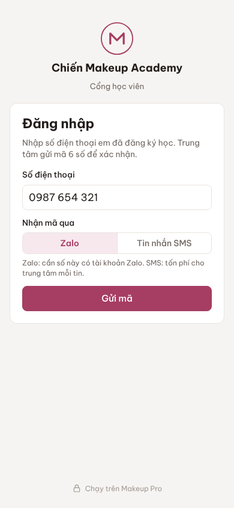 | 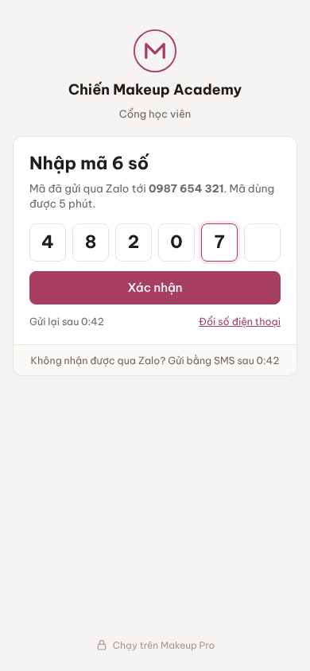 | 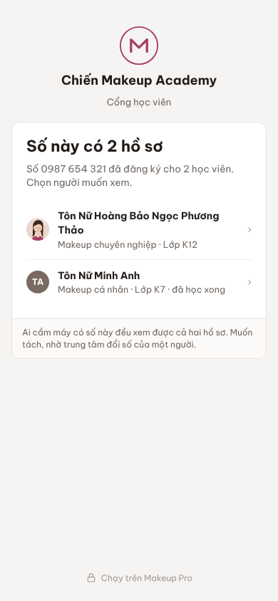 | 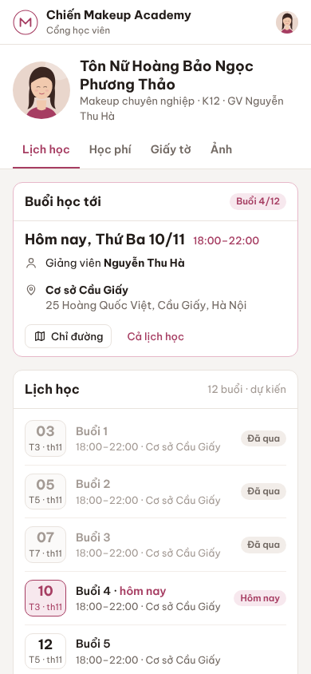 | 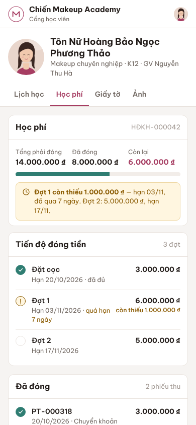 |

Trên máy tính: 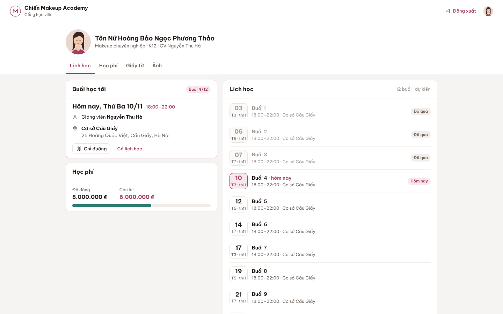

- **Cách vào:** học viên tự mở trang cổng, nhập số điện thoại, chọn nhận mã qua **Zalo (ZNS)** hoặc **SMS**, rồi nhập mã 6 số. Trung tâm không phải mời ai: số điện thoại đã có trong hồ sơ học viên (`Customer.phone`).
- **Bố cục:** đầu trang ghi tên, khoá, giảng viên. Dưới là 4 thẻ tab: Lịch học, Học phí, Giấy tờ, Ảnh. Trên máy tính có hai cột: buổi tới + tóm tắt học phí bên trái, lịch đủ 12 buổi bên phải.
- **Ưu:** chặt nhất trong ba cách, vì phải cầm đúng điện thoại. Không phải nhớ mật khẩu. Trung tâm không phải gửi gì.
- **Nhược:**
  - **Tốn tiền mỗi lần đăng nhập** (mỗi mã là một tin).
  - Phải đăng ký SMS brandname hoặc Zalo OA và xin duyệt mẫu tin. Theo một hướng dẫn tích hợp eSMS (qua kết quả tìm kiếm), duyệt tên thương hiệu thường mất 3–5 ngày làm việc.
  - ZNS chỉ tới được số có tài khoản Zalo.
  - Phải chống kẻ xấu bấm gửi mã liên tục để làm tốn tiền.
  - Số điện thoại trong hồ sơ **không duy nhất**: mẹ có thể đăng ký cho cả hai con. Vì vậy cần màn "chọn hồ sơ".
- **Công sức: khoảng 10 buổi.**
  - Mã OTP, gắn nhà cung cấp ZNS/SMS, chống gửi dồn, chọn hồ sơ: 3,5
  - Đường đọc dữ liệu "của tôi": 2
  - Giao diện tab: 2,5
  - Bật hoặc tắt cổng ở phía trung tâm: 0,5
  - Bài thử chặn lộ dữ liệu: 1,5
  - Chưa tính những ngày chờ duyệt mẫu tin hoặc tên thương hiệu.
- **Chi phí:** theo số tin. **Chưa kiểm được giá:**
  - Trang giá của eSMS (esms.vn) và Zalo Cloud (zalo.cloud) **không mở được** từ máy R&D (lỗi không phân giải tên miền).
  - Tìm kiếm không ra bảng giá ZNS hay SMS brandname năm 2026.
  - Có một bài Sforum (cập nhật 04/2025, **chưa kiểm lại**) ghi gói Zalo OA giá 84.000 đ và 165.000 đ/tháng. Đó là phí gói tài khoản, chưa phải giá mỗi tin.
  - Trước khi chọn C, anh hỏi báo giá trực tiếp nhà cung cấp.

### 1.3 Rủi ro bảo mật và cách chặn

**Chặn chung, phương án nào cũng phải làm (thợ làm, bài thử kiểm):**
1. **Không xem được của người khác bằng cách sửa đường dẫn.** Máy chủ lấy "học viên là ai" từ **phiên đăng nhập**, không bao giờ lấy từ số hay mã trên địa chỉ web. Mọi câu hỏi dữ liệu đều lọc theo `customerId` của phiên và theo tổ chức.
2. **Thẻ đăng nhập của cổng là loại riêng.** Máy chủ từ chối thẻ này ở mọi đường dành cho nhân viên: dù khéo đến đâu, học viên cũng không gọi được màn quản trị.
3. **Ảnh thẻ không để công khai** (`StoredFile.isPublic` = false). Máy chủ chỉ đưa ảnh qua một địa chỉ có hạn ngắn, và chỉ khi `DesignCard.customerId` đúng là học viên đó.
4. **Không có gì về người khác:** không danh sách bạn cùng lớp, không số điện thoại giảng viên, không ghi chú nội bộ.
5. **Ghi nhật ký** (`AuditLog`) mỗi lần vào cổng và mỗi lần có máy mới. **Giới hạn số lần thử**: máy chủ đã có sẵn cơ chế giới hạn cho đăng nhập (`rateLimit: 'auth'`, `apps/api/src/modules/auth/routes.ts`).
6. **Số điện thoại phải đúng.** Nếu nhân viên gõ nhầm số, người lạ có thể nhận mã (C) hoặc khớp 4 số cuối (B). Đề xuất trường `Customer.phoneVerifiedAt`: lần đầu bật cổng, trung tâm xác nhận số với học viên.

**Bài học từ Studio Pro** (bản sao chỉ đọc mà R&D vòng trước để ở `…/scratchpad/repos/ssaas`):
- Khách tra hợp đồng bằng số điện thoại + mã hợp đồng, nhưng phép so sánh chạy **ngay trong trình duyệt**, trên **toàn bộ** danh sách hợp đồng tải về máy (`pages/overview/CustomerOverview.tsx` dòng 717–730). Ai mở công cụ của trình duyệt cũng đọc được hết.
- Hai lời báo lỗi khác nhau ("Mã số hợp đồng không tồn tại" và "SĐT không … đúng") cho phép người ngoài **dò ra mã nào có thật**.
- Ngoài ra còn một chỗ gắn `?accessToken=SUPER_ADMIN_BYPASS` lên địa chỉ (`App.tsx` dòng 482).

Makeup Pro **kiểm ở máy chủ, chỉ trả một lời báo chung**, và không đặt bất kỳ chìa "vượt quyền" nào trên địa chỉ.

**Rủi ro riêng từng cách vào:**

| | Rủi ro | Cách chặn |
|---|---|---|
| A | Mật khẩu yếu hoặc dùng lại từ nơi khác. Học viên cho bạn mượn mật khẩu. Email bị chiếm nên kẻ xấu đặt lại được mật khẩu. | Tối thiểu 8 ký tự và chặn mật khẩu phổ biến. Khoá tạm sau nhiều lần sai. Thư đặt lại dùng một lần, hết hạn 30 phút. Gửi thư báo khi có máy mới đăng nhập. Trung tâm khoá được tài khoản. |
| B | **Đường dẫn bị chuyển tiếp** (ví dụ học viên dán nhầm vào nhóm Zalo lớp). | (1) Phải nhập **4 số cuối số điện thoại**. (2) Mỗi đường dẫn chỉ cấp tối đa **2 máy**, hết suất là khoá. (3) Trung tâm thấy danh sách máy đã mở và bấm "Chặn máy này" hoặc "Thu hồi đường dẫn". (4) Đường dẫn chưa mở thì hết hạn sau 7 ngày. |
| B | **Máy của Zalo tự mở đường dẫn để làm ảnh xem trước.** Nếu chỉ cần mở là vào được, máy xem trước sẽ dùng mất suất. Một bài tìm kiếm ghi hiện tượng tương tự với đường dẫn gửi qua email: máy quét thư tự bấm làm hỏng đường dẫn dùng một lần. | Chìa khoá đặt **sau dấu `#`** trên địa chỉ. Phần này trình duyệt **không gửi lên máy chủ**, nên máy xem trước không lấy được. Học viên phải **bấm nút** "Mở trang của tôi" thì chìa mới đổi thành phiên. Sau đó trang xoá chìa khỏi thanh địa chỉ. Lưu ý: R&D **chưa thử** máy xem trước của Zalo xử lý thế nào, đây là suy luận từ cách trình duyệt hoạt động. |
| B | Bạn cùng lớp biết số điện thoại (số lộ trong nhóm lớp), nên 4 số cuối không còn bí mật. | Giới hạn 2 máy, trung tâm thấy máy lạ. Nhập sai 5 lần thì khoá. Phần rủi ro còn lại: **ghi thẳng cho anh biết**, cách B chặt kém C. |
| B | Mất điện thoại. | Trung tâm bấm "Chặn máy này". Học viên có nút "Thoát khỏi máy này". |
| C | **Bơm tin**: kẻ xấu bấm "Gửi mã" liên tục vào số người khác để làm trung tâm tốn tiền. | Mỗi số tối đa 3 mã/giờ, mỗi địa chỉ mạng tối đa 10 mã/giờ. Từ lần thứ 2 thêm câu đố chống máy tự động. Chỉ gửi khi số có trong hồ sơ, nhưng **luôn trả cùng một câu** "Nếu số đã đăng ký, mã sẽ tới", để người ngoài không dò được ai là học viên. |
| C | Dò mã 6 số. | Sai 5 lần thì huỷ mã. Mã sống 5 phút. |
| C | Một số điện thoại dùng chung cho nhiều học viên. | Màn "Số này có 2 hồ sơ" ghi rõ "Ai cầm máy có số này đều xem được cả hai". Muốn tách thì trung tâm đổi số. |

### 1.4 Đã học từ đâu

| Nguồn | Truy cập được? | Học gì |
|---|---|---|
| Studio Pro (bản sao chỉ đọc trong thư mục nháp) | Có, đọc mã | (1) Cách tra hợp đồng của khách và hai lỗi ở mục 1.3. (2) Tài khoản khách đăng nhập chung cửa với nhân viên, phân biệt bằng `user.team === 'Khách hàng'` (`App.tsx` dòng 282). Mình làm cửa và thẻ **riêng** cho học viên. (3) Nút "Lưu vào Album ảnh" dùng chức năng chia sẻ của trình duyệt (`utils/downloadHelper.ts` dòng 50–140). Mình dùng lại ý này cho nút "Lưu vào Ảnh" của thẻ chào mừng. |
| Mindbody: app mang thương hiệu riêng cho studio (https://www.mindbodyonline.com/business/branded-app) | Chỉ đọc **đoạn trích của công cụ tìm kiếm**. Đây là trang quảng cáo của chính hãng. | Khách của studio có app mang logo studio để xem lịch, mua và nhận thông báo. Mindbody làm app staff riêng. Mình học ý "cổng mang **logo trung tâm**, chỉ ghi nhỏ 'Chạy trên Makeup Pro'". |
| Slack, cách đăng nhập "Email me a magic link" (trang hướng dẫn IT của một trường đại học, qua tìm kiếm) | Chỉ đọc đoạn trích | Đường dẫn dùng một lần, và hiện tượng máy quét tự bấm làm hỏng đường dẫn. Từ đó có nút "Mở trang của tôi" ở phương án B. |
| Sapo: thêm cách nhận OTP qua Zalo (https://www.sapo.vn/cap-nhat-tinh-nang/cap-nhat-giao-dien-dang-nhap-va-them-phuong-thuc-nhan-tin-otp-qua-zalo) | Chỉ đọc đoạn trích | Mã OTP qua ZNS tới gần như ngay, nhưng phải đúng số có Zalo. Từ đó có lựa chọn "Zalo / Tin nhắn SMS" ở phương án C. |
| VietGuys so sánh OTP qua SMS, email và ZNS (brandsvietnam.com) | Chỉ đọc đoạn trích, không có con số | Bài nói ZNS thường rẻ hơn SMS brandname, nhưng không ghi giá. |
| Fresha, Teachable | **Chưa khảo sát được.** fresha.com không mở được (đã ghi ở BAO-CAO-RND-04), support.teachable.com lỗi không phân giải tên miền. | Bố cục thẻ của A **không** học từ hai app này. Đây là suy luận từ màn Thu tiền đào tạo R&D vòng 3 (khuôn "tiến độ đóng tiền") và trang công khai thương hiệu đang có (`docs/nghiem-thu/bai-thu-lan-4/R1-trang-cong-khai-390.png`). |

### 1.5 Đề xuất của R&D: chọn B

1. **Rẻ và làm được ngay:** 0 đồng, không chờ nhà mạng hay Zalo duyệt. Máy chủ chưa có dịch vụ gửi thư hay SMS nào, B không cần cái nào.
2. **Hợp cách trung tâm đang làm:** trung tâm vẫn nhắn học viên qua Zalo. B chỉ thêm một tin dán sẵn.
3. **Ít bấm nhất cho học viên:** bấm đường dẫn, nhập 4 số, xong. Về sau mở lại không phải làm gì.
4. **Một trang** hợp với người vào xem vài lần mỗi tháng.
5. **Nâng cấp dễ:** sau này cần chặt hơn thì thêm C (OTP qua ZNS) làm **cách vào thứ hai**, dùng chung đường đọc dữ liệu và giao diện. Không bỏ phí phần nào.

Điều R&D nói thẳng: B chặt **kém** C. Ai có cả đường dẫn lẫn 4 số cuối thì vào được, trong giới hạn 2 máy. Nếu anh coi tiền học phí là thông tin rất nhạy cảm, chọn C và chấp nhận phí tin nhắn.

### 1.6 Đề xuất trường mới (chưa có trong `schema.prisma`)

| Trường hoặc bảng mới | Dùng cho | Nội dung chính |
|---|---|---|
| `PortalLink` | B | tổ chức, học viên, mã băm của chìa, người tạo, hạn dùng (7 ngày nếu chưa mở), lúc thu hồi, số lần nhập sai, lúc khoá, số máy tối đa (2) |
| `PortalDevice` | A, B, C | học viên, tên máy (đọc từ trình duyệt), họ phiên đăng nhập, lúc mở đầu, lúc dùng cuối, lúc chặn |
| `PortalAccount` | A | học viên (duy nhất), email, mật khẩu đã băm, lúc mời, lúc kích hoạt, trạng thái |
| `PortalOtp` | C | số điện thoại, mã đã băm, kênh (ZALO/SMS), hạn dùng, số lần thử, địa chỉ mạng gửi |
| `Customer.phoneVerifiedAt` | B, C | lúc trung tâm xác nhận số điện thoại đúng của học viên |
| `ClassSession` | cả ba | buổi học thật: lớp, ngày, giờ, trạng thái (theo lịch / dời / huỷ), ghi chú. Việc "buổi học tự lên Lịch" trong `docs/VIEC-TON.md` cũng cần bảng này. |
| `SessionAttendance` (làm sau) | cả ba | điểm danh từng buổi, để "Đã qua" thành "Có mặt / Vắng" |
| `Payment.installmentId` (tuỳ chọn) | cả ba | phiếu thu trả cho đợt nào. Không có thì máy chủ dồn tiền theo thứ tự đợt, như bản mẫu đang làm. |
| `OrganizationProfile.bankName`, `bankAccountNo`, `bankAccountName` | cả ba | ô "Cách đóng tiền". Sau này có thể làm thêm mã QR chuyển khoản. |
| `DesignCard.portalVisible` | cả ba | trung tâm chọn ảnh nào học viên được thấy (anh quyết mặc định, mục 0 câu 3) |

---

## 2. Đề tài 2: App iPhone

Bản yêu cầu ghi app iPhone dùng để "**thợ xem lịch, nhận phân công**" (`docs/PRD.md` dòng 76). Cổng học viên ở đề tài 1 cũng có thể "cài" lên iPhone giống hệt.

Thuật ngữ dùng trong mục này:
- **Thông báo đẩy**: tin hiện trên màn khoá dù không mở app.
- **PWA**: trang web có thêm tệp mô tả (manifest) và biểu tượng. Người dùng "Thêm vào Màn hình chính" thì trang mở toàn màn hình như một app, không có thanh địa chỉ.
- **Capacitor**: bộ công cụ miễn phí, bọc trang web có sẵn thành app iPhone để nộp lên App Store.
- **App Store review**: Apple duyệt từng bản trước khi cho tải.
- **TestFlight**: kênh của Apple để phát bản thử cho một nhóm người.
- **APNs**: đường gửi thông báo đẩy của Apple.
- **D-U-N-S**: mã số doanh nghiệp 9 chữ số do Dun & Bradstreet cấp. Apple dùng mã này để xác minh công ty.

### 2.1 Hướng 1: Web cài lên màn hình chính iPhone (PWA)

| Hướng dẫn cài (trong app) | Màn hình chủ sau khi cài | Mở từ biểu tượng: **web thật** | Lịch: **web thật** | Thông báo trên màn khoá |
|---|---|---|---|---|
| 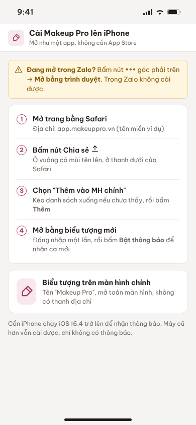 | 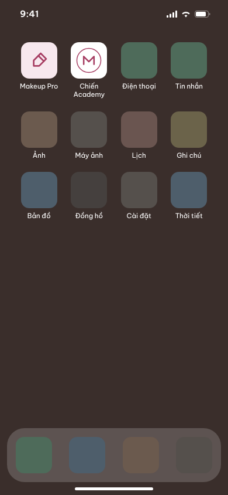 | 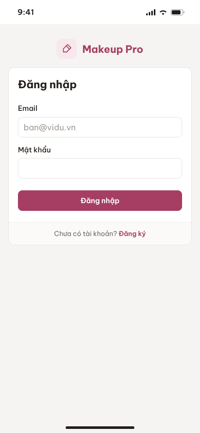 | 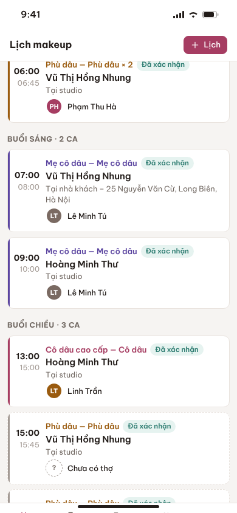 | 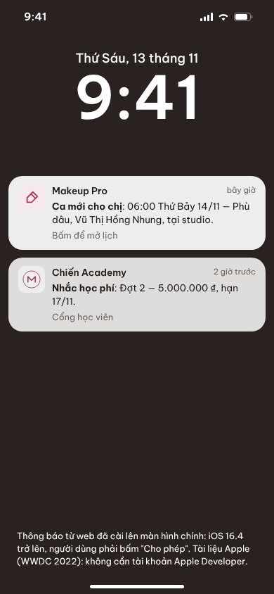 |

Ghi chú về ảnh:
- Hai ảnh "web thật" đúng là **bản web hiện có**. Ảnh đăng nhập chụp bản build `apps/web/dist` ở khổ 390×797 (chiều cao màn hình trừ thanh trạng thái, đúng như khi chạy toàn màn hình). Ảnh lịch cắt từ ảnh nghiệm thu `docs/nghiem-thu/bai-thu-lan-4/MOI-ca-cua-dong-da-huy-390.png`.
- Thanh trạng thái, màn hình chủ và màn khoá là **hình vẽ giả lập**. R&D **không có iPhone thật** để chụp, và Chromium không giả lập được chế độ "đứng riêng" của iOS.
- Bản web hiện tại **chưa có** tệp mô tả (manifest), biểu tượng iPhone hay phần chạy nền (`apps/web/index.html` chỉ có tiêu đề). Hiện giờ "Thêm vào MH chính" vẫn được, nhưng R&D **chưa thử trên iPhone thật** xem mở ra thế nào. Ảnh trên là dáng **sau khi** thợ thêm các tệp đó.

Chi tiết hướng 1:
- **Cài thế nào (anh, thợ, studio khác):**
  1. Mở đường dẫn bằng **Safari**.
  2. Bấm nút Chia sẻ, chọn "Thêm vào MH chính".
  3. Bấm biểu tượng mới để mở.

  App có sẵn màn hướng dẫn 4 bước. Nếu người dùng đang mở trong Zalo, màn này nhắc "Mở bằng trình duyệt": R&D suy luận trình duyệt bên trong Zalo không có nút thêm vào màn hình chính, **chưa thử trên máy thật**. Studio khác chỉ cần nhận đường dẫn, không qua App Store.
- **Thông báo đẩy: có**, từ **iOS/iPadOS 16.4**, với hai điều kiện: trang đã được thêm vào màn hình chính, và người dùng **tự bấm** nút cho phép. Nguồn: tài liệu của OneSignal và MoEngage qua kết quả tìm kiếm. **Không cần tài khoản Apple Developer**: Apple nói trong buổi WWDC 2022 "Meet Web Push for Safari" (đọc qua đoạn trích tìm kiếm; trang webkit.org không mở được). Máy chủ chỉ cần một cặp khoá tự sinh miễn phí (gọi là VAPID) và một bảng lưu máy đã đăng ký nhận tin. Máy chạy iOS cũ hơn 16.4 vẫn cài được, chỉ không có thông báo.
- **Cần gì từ anh:** tên miền + HTTPS, cái này web vốn đã cần. **Không có phí thêm.**
- **Công sức: khoảng 5 buổi.**
  - Tệp mô tả, biểu tượng, màn hướng dẫn cài: 1
  - Phần chạy nền (mở nhanh, báo khi mất mạng): 1
  - Thông báo đẩy (đăng ký nhận, lưu, gửi khi có ca mới hoặc đổi ca, nút bật/tắt, thử trên iPhone thật): 3

  Nếu chưa cần thông báo đẩy thì chỉ khoảng 2 buổi.
- **Rủi ro duyệt App Store:** **không có**, vì không qua App Store.
- **Rủi ro khác:**
  - Người lớn tuổi có thể lúng túng khi cài.
  - Không có tên trên App Store.
  - Không có widget, không có Face ID.
  - Đăng nhập dùng cookie giới hạn ở đường `/api/v1/auth`. Phiên có được giữ ở chế độ toàn màn hình hay không thì **chưa đo** trên iPhone thật.

### 2.2 Hướng 2: Bọc web thành app bằng Capacitor (lên App Store)

| Mở khoá bằng Face ID | Mất mạng vẫn xem lịch đã lưu |
|---|---|
| 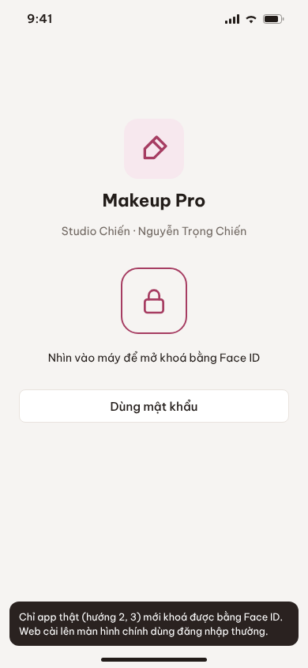 | 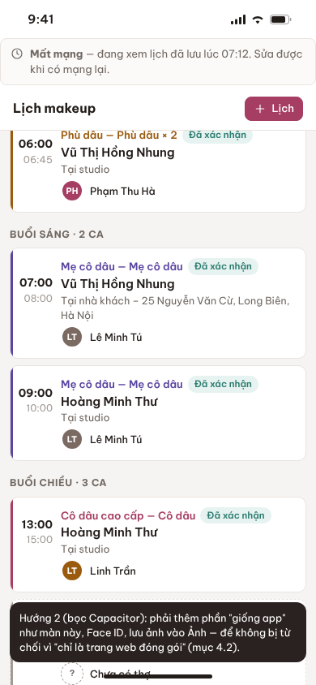 |

- **Cài thế nào:** tải từ App Store. Hai cách phát:
  - **Công khai**: ai tìm cũng thấy.
  - **"Phân phối không niêm yết"** (Unlisted app distribution): không hiện khi tìm kiếm, chỉ ai có đường dẫn mới tải được. Cách này **vẫn phải qua duyệt** (trang Apple https://developer.apple.com/support/unlisted-app-distribution/, đọc ngày 19/10/2026). Apple khuyên tự làm thêm cách chặn người lạ dùng app.

  Thử nội bộ thì dùng TestFlight.
- **Thông báo đẩy: có**, qua APNs. Cần tài khoản Apple Developer.
- **Cần gì từ anh:**
  - **Apple Developer Program: 99 USD mỗi năm.** R&D đã kiểm trang chính thức https://developer.apple.com/programs/enroll/ ngày 19/10/2026. Nguyên văn: "99 USD per membership year. Prices may vary by region and are listed in local currency during the enrollment process."
  - **Đăng ký cá nhân**: App Store hiện **tên anh** là người bán.
  - **Đăng ký công ty**: cần
    - một **pháp nhân** ký được hợp đồng. Apple ghi không nhận "DBAs, fictitious business names, trade names, or branches", nên hộ kinh doanh có được nhận không thì **R&D chưa rõ, cần hỏi Apple**;
    - **số D-U-N-S**;
    - **website** chạy được, tên miền đứng tên công ty (Apple không nhận trang mạng xã hội);
    - **email theo tên miền** công ty.
  - Một **máy Mac** có Xcode để đóng gói, hoặc thuê dịch vụ đóng gói trên mây (**chưa kiểm giá**).
  - Trang **chính sách quyền riêng tư**.
  - **Tài khoản thử** cho người duyệt.
- **Công sức: khoảng 10–12 buổi**, chưa tính thời gian chờ duyệt.
  - Dựng khung Capacitor, biểu tượng, màn chờ, đóng gói: 2
  - Thông báo qua APNs: 2,5
  - Phần "giống app" để không bị từ chối (Face ID, xem lịch đã lưu khi mất mạng, lưu ảnh vào Ảnh, bấm thông báo mở đúng màn): 3
  - Hồ sơ App Store (ảnh, mô tả, chính sách riêng tư, tài khoản thử, nút xoá tài khoản): 1,5
  - Sửa theo phản hồi của người duyệt: 1–3

  Tài liệu Capacitor (capacitorjs.com) **không mở được** trong phiên này. Phần mô tả Capacitor là hiểu biết chung của R&D, thợ phải kiểm lại khi làm.
- **Rủi ro duyệt App Store: trung bình tới cao.** Nguyên văn hướng dẫn duyệt của Apple, đọc ngày 19/10/2026 (https://developer.apple.com/app-store/review/guidelines/):
  - **4.2**: "Your app should include features, content, and UI that elevate it beyond a repackaged website." Bọc web trần thì dễ bị từ chối, nên phải có phần "giống app" như hai ảnh trên.
  - **2.1(a)**: nếu app có đăng nhập thì phải đưa người duyệt tài khoản thử và **bật máy chủ**.
  - **5.1.1(v)**: "If your app supports account creation, you must also offer account deletion within the app." Web hiện có nút "Đăng ký", nên app phải có **xoá tài khoản**.
  - **3.1.1**: mở khoá tính năng (ví dụ gói thuê bao) **trong app** thì phải dùng thanh toán của Apple. **Gói cước Makeup Pro không được bán hay mời mua trong app iPhone**, gia hạn làm trên web. 3.1.3(c) cho phép ngoại lệ khi app chỉ bán trực tiếp cho tổ chức dùng cho nhân viên hoặc học viên; R&D **không chắc** Apple xếp Makeup Pro vào loại đó.

### 2.3 Hướng 3: Viết app iPhone riêng

| Lịch kiểu iPhone | Widget trên màn hình chủ |
|---|---|
| 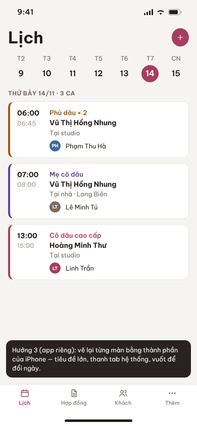 | 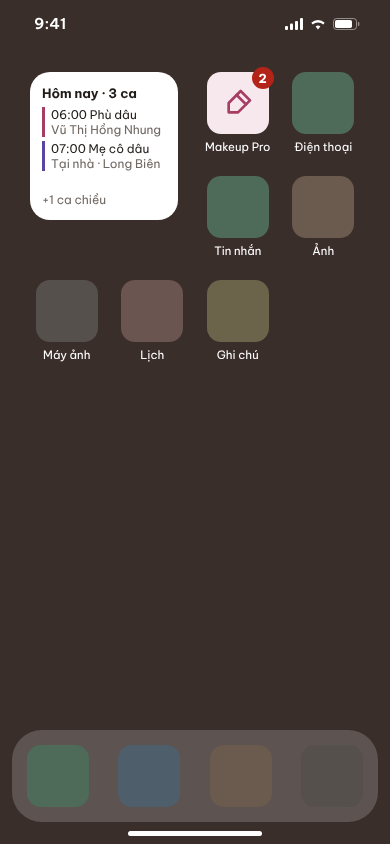 |

- **Cài thế nào:** qua App Store, như hướng 2.
- **Thông báo đẩy: có** (APNs). Thêm được **widget** (ô "Hôm nay · 3 ca" ngay trên màn hình chủ), số đỏ trên biểu tượng, Face ID, chạy mượt và ổn hơn khi mất mạng.
- **Cần gì từ anh:** như hướng 2 (99 USD/năm, máy Mac…), cộng thêm **người viết app iPhone**.
- **Công sức:**
  - Chỉ phần của thợ (lịch, phân công, xem hợp đồng, thông báo): **khoảng 25–35 buổi**.
  - Đủ chức năng như web: **trên 60 buổi**.
  - Về lâu dài, **mỗi tính năng mới phải làm hai lần**, một cho web, một cho app.
- **Rủi ro duyệt App Store:** thấp nhất ở mục 4.2. Các mục 2.1, 5.1.1(v), 3.1.1 vẫn như hướng 2.

### 2.4 So sánh ba hướng

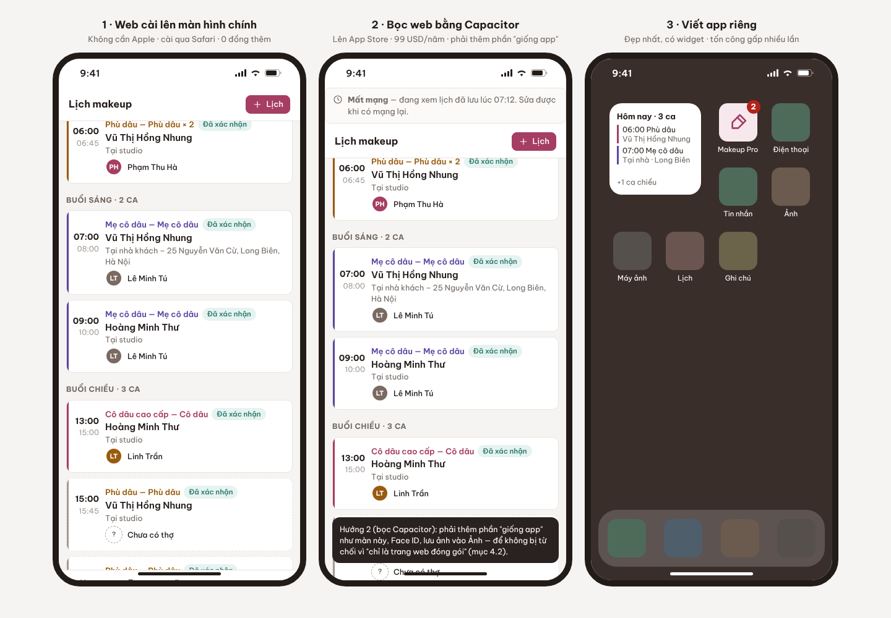

| | 1 · Web cài lên màn hình chính | 2 · Bọc bằng Capacitor | 3 · App riêng |
|---|---|---|---|
| Cài | Safari → Chia sẻ → Thêm vào MH chính | App Store (công khai hoặc không niêm yết) | App Store |
| Thông báo đẩy | Có (iOS 16.4+, phải cài và bấm cho phép) | Có | Có |
| Widget, Face ID | Không | Face ID có, widget phải viết thêm | Có |
| Tài khoản Apple | **Không cần** | 99 USD/năm | 99 USD/năm |
| Máy Mac | Không cần | Cần (hoặc thuê đóng gói) | Cần |
| Công sức | khoảng 5 buổi | khoảng 10–12 buổi + chờ duyệt | 25–35 buổi (phần thợ) |
| Rủi ro duyệt | Không có | Trung bình–cao (4.2) | Thấp (4.2) |
| Sửa web là app đổi theo | Có | Phần lớn có | Không |

### 2.5 Đã học từ đâu

| Nguồn | Truy cập được? | Học gì |
|---|---|---|
| Apple, trang đăng ký Developer Program | **Có**, đọc trực tiếp 19/10/2026 | 99 USD/năm, giá theo vùng, điều kiện đăng ký công ty (D-U-N-S, pháp nhân, website, email tên miền) |
| Apple, App Review Guidelines | **Có**, đọc trực tiếp | Nguyên văn 2.1(a), 3.1.1, 3.1.3(c), 3.1.3(f), 4.2, 4.2.3, 5.1.1(v) |
| Apple, Unlisted app distribution | **Có**, đọc trực tiếp | Phát app chỉ qua đường dẫn, vẫn phải duyệt |
| Apple, WWDC 2022 "Meet Web Push for Safari" | Chỉ qua đoạn trích tìm kiếm (webkit.org không mở được) | Web push không cần tài khoản Apple Developer |
| OneSignal, MoEngage (tài liệu thông báo đẩy web trên iOS) | Chỉ qua đoạn trích tìm kiếm | iOS 16.4+, phải thêm vào màn hình chính, cần tệp mô tả, người dùng phải bấm cho phép. Hai bên **nói khác nhau** ở chỗ Chrome trên iPhone có đăng ký nhận được không, nên R&D chỉ hướng dẫn dùng **Safari**. |
| Mindbody: app riêng cho staff và app mang thương hiệu cho khách | Chỉ qua đoạn trích (trang quảng cáo của hãng) | Tách "app cho người làm" và "app cho khách". Ở Makeup Pro, đó là biểu tượng **Makeup Pro** (thợ, chủ) và biểu tượng **Chiến Academy** (học viên), như ảnh màn hình chủ. |
| Studio Pro (bản sao chỉ đọc) | Có, đọc mã | Là web Vite, **không** có tệp mô tả hay phần chạy nền (đã tìm `manifest`, `serviceWorker`, `capacitor`: không thấy). Có nút lưu ảnh vào Album bằng chức năng chia sẻ của trình duyệt, chạy được trên iPhone mà không cần app. |
| Capacitor (capacitorjs.com) | **Chưa khảo sát được** (lỗi phân giải tên miền) | Mô tả Capacitor ở 2.2 là suy luận từ hiểu biết chung, thợ phải kiểm khi làm |

### 2.6 Đề xuất của R&D: chọn hướng 1, giữ đường sang hướng 2

1. **Đủ cho việc chính** "thợ xem lịch, nhận phân công". Thông báo "Ca mới cho chị…" tới màn khoá được, từ iOS 16.4.
2. **0 đồng, không cần Apple, không chờ duyệt.** Anh chưa có tài khoản Apple Developer (`docs/PROGRESS.md` dòng 54).
3. **Một mã cho cả web và điện thoại**: thợ sửa web là iPhone đổi theo.
4. **Cổng học viên dùng cùng cách**: học viên cũng "cài" được biểu tượng của trung tâm.
5. **Không phí công:** phần thông báo phía máy chủ và giao diện điện thoại làm cho hướng 1 dùng lại được nếu sau này chuyển sang hướng 2.

**Khi nào nên chuyển sang hướng 2:** khi anh muốn có tên trên App Store để bán Makeup Pro cho studio khác, hoặc khi thợ dùng thật mà thấy thông báo không ổn định.

**Hướng 3 chưa đề xuất ở giai đoạn này.** Công làm gấp nhiều lần, và mọi tính năng về sau phải làm hai lần.

**Thông báo đẩy phải có bảng mới** `PushSubscription`, gồm: người nhận (thành viên hoặc học viên), địa chỉ nhận, khoá, lúc tạo, lúc gửi được gần nhất, lúc huỷ. Thêm cài đặt bật/tắt từng loại tin. Việc thông báo cũng đang nằm trong danh sách chưa làm (`docs/PROGRESS.md` dòng 43), nên nên làm chung một lượt.

---

## 3. Danh sách ảnh

Tất cả ở /home/user/a/docs/rnd/anh-rnd06/. Mỗi ảnh dưới 400 KB.

| Nhóm | Ảnh |
|---|---|
| Cổng học viên, phương án A | `hv-A-trung-tam-moi-1440.png`, `hv-A-dang-nhap-390.png`, `hv-A-trang-chu-390.png`, `hv-A-trang-chu-truong-390.png`, `hv-A-hoc-phi-390.png`, `hv-A-ho-so-390.png`, `hv-A-trang-chu-1440.png` |
| Cổng học viên, phương án B | `hv-B-trung-tam-gui-1440.png`, `hv-B-trung-tam-gui-390.png`, `hv-B-mo-may-moi-390.png`, `hv-B-sai-khoa-390.png`, `hv-B-trang-390.png`, `hv-B-trang-hoc-phi-390.png`, `hv-B-trang-truong-390.png`, `hv-B-trang-1440.png` |
| Cổng học viên, phương án C | `hv-C-so-dien-thoai-390.png`, `hv-C-nhap-ma-390.png`, `hv-C-chon-ho-so-390.png`, `hv-C-lich-hoc-390.png`, `hv-C-hoc-phi-390.png`, `hv-C-hoc-phi-truong-390.png`, `hv-C-lich-hoc-1440.png` |
| App iPhone | `ip-1-huong-dan-cai-390.png`, `ip-1-man-hinh-chu-390.png`, `ip-1-mo-rieng-web-that-390.png`, `ip-1-lich-web-that-390.png`, `ip-1-thong-bao-390.png`, `ip-2-face-id-390.png`, `ip-2-mat-mang-390.png`, `ip-3-lich-app-rieng-390.png`, `ip-3-widget-390.png`, `ip-so-sanh-ba-huong-1440.png` |
| Tài nguyên dùng trong bản mẫu | `the-chao-mung.png` và `the-feedback.png`: thẻ chào mừng và thẻ feedback, chụp từ mẫu R&D vòng 3 (`v3-mau-chao-mung/shd-01.html`, `v3-mau-feedback/fb-01.html`). `that-web-dang-nhap.png` và `that-web-lich.png`: ảnh thật của bản web hiện có. |

Ảnh có đuôi `-truong` là ảnh dán nhãn trường dữ liệu. Nhãn nằm chồng lên nhau ở vài chỗ chật; bảng ở mục 1.1 là bản đầy đủ.

Dữ liệu mẫu (tên, số điện thoại, số tài khoản) đều là **dữ liệu bịa để minh hoạ**. Ngày giả định trong bản mẫu cổng học viên là Thứ Ba 10/11/2026.
