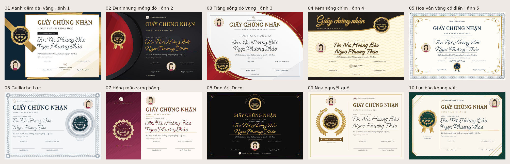

# Báo cáo R&D 08: Cấp chứng chỉ tốt nghiệp + 10 mẫu chứng nhận

- Sản phẩm: Makeup Pro
- Người đọc: anh Chiến
- Ngày: 19/10/2026
- Người làm: Trung tâm R&D, chặng 1 (bày phương án, có ảnh thật, chưa phải bản vẽ cho thợ)
- Việc anh giao (nguyên văn): *"Và thêm giúp tôi các mẫu tốt nghiệp này để khi thực tế kết thúc khóa học sẽ có tính năng cấp chứng chỉ từng học sinh nếu bấm vào sẽ có từng mẫu cho từng học viên và có thể đẻ in được nhé tích hợp tính năng in trên điện thoại luôn bao gồm chọn 1 hoặc nhiều để in"* và *"Thêm giúp tôi 10 mẫu chứng nhận tốt nghiệp nữa để người dùng có thể dùng và lựa chọn nhé"*

---

## 1. Xem gì trước (3 ảnh)

1. **10 mẫu trên một bảng:** /home/user/a/docs/rnd/anh-rnd08/bang-xem-nhanh-10-mau.png
2. **3 phương án luồng cấp, đặt cạnh nhau:** /home/user/a/docs/rnd/anh-rnd08/ba-phuong-an-1440.png
3. **In thử 5 học viên, mỗi mẫu 5 trang PDF:** /home/user/a/docs/rnd/anh-rnd08/in-thu-pdf-mau-01-05.png và …/in-thu-pdf-mau-06-10.png

## 2. Kết luận và đề xuất của R&D

**Luồng: chọn phương án A (bấm từ thẻ lớp), thêm một lối phụ lấy từ C (in lại từng người trong hồ sơ học viên).** Lý do: anh nói *"khi thực tế kết thúc khóa học"* và *"chọn 1 hoặc nhiều"*. Thời điểm cấp gắn với **lớp**, nên nút đặt ngay trên thẻ lớp. Vào là thấy cả lớp có ô chọn sẵn, nên cấp cả lớp chỉ mất **3 lần bấm** (Cấp chứng chỉ → Cấp và in → In). Phương án B (đi từ Mẫu thiết kế) bắt chọn mẫu trước rồi mới chọn lớp, ngược với cách trung tâm làm việc. C chỉ in được từng người một.

**In trên điện thoại: làm tệp PDF ngay trong máy rồi mở bảng Chia sẻ của điện thoại.** Không dựa vào lệnh in của trình duyệt. Mục 5 giải thích lý do: iPhone hay in sai hướng ngang.

**10 mẫu đã vẽ xong, có PNG và PDF thật.** Mẫu nào cũng có ô ảnh học viên khung tròn. Đây là R&D áp luật anh đặt ngày 19/10/2026: *"Mẫu nào cũng phải có ảnh nhé"* và *"khung ảnh mặc định để hình tròn"*. Theo R&D, ảnh làm **2 mẫu kém trang trọng đi (03 và 05)**, xem mục 3.3. Việc này anh quyết.

**Một điều nên kiểm trước khi phát hành (R&D không phải luật sư):** ở Việt Nam, chữ "chứng chỉ" dễ bị hiểu là văn bằng của cơ sở giáo dục nghề nghiệp được cấp phép. Trung tâm không có phép đó thường ghi **"Giấy chứng nhận"**. Vì vậy R&D để 6/10 mẫu mặc định là "CHỨNG NHẬN TỐT NGHIỆP", 4 mẫu còn lại là "CHỨNG CHỈ HOÀN THÀNH KHOÁ HỌC". Tiêu đề đổi được.

## 3. Mười mẫu chứng nhận tốt nghiệp

### 3.1 Tệp và cách xem

| Cái gì | Ở đâu |
|---|---|
| 10 mẫu HTML (mở bằng trình duyệt) | /home/user/a/docs/rnd/v8-mau-chung-chi/cc-01.html … cc-10.html |
| Trang bày cả 10 mẫu | /home/user/a/docs/rnd/v8-mau-chung-chi/index.html |
| PNG thật 1754×1240 (A4 ngang, 150 dpi; dpi là số điểm ảnh trên mỗi inch giấy), có logo và không logo, 20 tệp | /home/user/a/docs/rnd/v8-mau-chung-chi/png/cc-NN-co-logo.png, cc-NN-khong-logo.png |
| PDF in thử: 5 học viên = 5 trang | /home/user/a/docs/rnd/v8-mau-chung-chi/in-thu/cc-01-5-hoc-vien.pdf, cc-08-5-hoc-vien.pdf |
| Ảnh xem từng mẫu (thu nhỏ, mỗi ảnh ≤ 600 KB) | /home/user/a/docs/rnd/anh-rnd08/mau-01.png … mau-10.png |
| Bảng 10 mẫu không logo, học viên chưa có ảnh | /home/user/a/docs/rnd/anh-rnd08/bang-10-mau-khong-logo.png |
| Cùng một mẫu với 4 phông chữ ký | /home/user/a/docs/rnd/anh-rnd08/chu-ky-4-phong-tren-mau-05.png |
| Mã dùng chung: điền dữ liệu, vẽ huy hiệu, co chữ | /home/user/a/docs/rnd/v8-mau-chung-chi/chung/cc.js, cc.css |

Thêm tham số vào cuối đường dẫn để thử dữ liệu khác: `?ten=Lê Thị Mai`, `&anh=0` (chưa có ảnh), `&logo=0` (không logo), `&ky=1..4` (đổi phông chữ ký), `&nhieu=1` (5 học viên, 5 trang; bấm Ctrl+P để in thử). Cách đặt tên tham số giống bộ thẻ chào mừng đang chạy (public/mau/chung/mau.js), để sau này ghép vào app ít phải sửa.

### 3.2 Bảng 10 mẫu

| # | Tên | Học từ | Tiêu đề mặc định | Phông tên |
|---|---|---|---|---|
| 01 | Xanh đêm dải vàng | ảnh 1 (cột xanh đen, dải vàng chéo, huy hiệu) | Chứng nhận tốt nghiệp | Chữ ký 1 |
| 02 | Đen nhung mảng đỏ | ảnh 2 (nền đen, mảng đỏ cong, huy hiệu có ruy băng) | Chứng nhận tốt nghiệp | Chữ ký 2 |
| 03 | Trắng sóng đỏ vàng | ảnh 3 (nền trắng, dải đỏ–vàng cong ở hai góc) | Chứng chỉ hoàn thành khoá học | Chữ ký 1 |
| 04 | Kem sóng chìm | ảnh 4 (nền kem sóng chìm, dải đen–vàng phía trên) | Chứng nhận tốt nghiệp | Chữ ký 3 |
| 05 | Hoa văn vàng cổ điển | ảnh 5 (viền hoa văn vàng, chữ xanh đậm) | Chứng nhận tốt nghiệp | Chữ ký 2 |
| 06 | Guilloche bạc | tự sáng tác ("guilloche" là các đường lượn đan nhau như trên tiền giấy, bằng cấp), học tông bạc của ảnh 5 | Chứng chỉ hoàn thành khoá học | Chữ ký 4 |
| 07 | Hồng mận vàng hồng | tự sáng tác: chia đôi, nửa trái màu mận gần màu app, ảnh tròn lớn | Chứng chỉ hoàn thành khoá học | Chữ ký 1 |
| 08 | Đen Art Deco | tự sáng tác: nền đen, khung vàng mảnh góc bậc thang | Chứng nhận tốt nghiệp | Chữ ký 2 |
| 09 | Ngà nguyệt quế | tự sáng tác: vòng nguyệt quế vàng ôm ảnh, dải ruy băng ghi năm | Chứng chỉ hoàn thành khoá học | Chữ ký 3 |
| 10 | Lục bảo khung vát | tự sáng tác: nền xanh lục bảo, tấm kem vát góc, huy hiệu đè mép dưới | Chứng nhận tốt nghiệp | Chữ ký 1 |

**Mẫu nào cũng có đủ:** tiêu đề tiếng Việt có dấu, "Trân trọng trao cho", tên học viên, dòng "Đã hoàn thành khoá Makeup chuyên nghiệp · Lớp K12", ngày cấp, số chứng chỉ, hai chỗ ký (Giảng viên / Giám đốc trung tâm, trên có chỗ trống ký tay và đóng dấu), logo và tên trung tâm, ô ảnh tròn, huy hiệu.

**Không chép ảnh tham khảo.** Ảnh anh gửi có hình mờ bản quyền Pikbest/pngtree. R&D chỉ học tinh thần: vàng kim trên nền tối, kem hoặc trắng; dải cong; huy hiệu tròn; viền hoa văn; hai dòng ký. Mọi hình đều tự vẽ: huy hiệu răng cưa có nguyệt quế, hoa văn viền, guilloche, quạt Art Deco, vòng nguyệt quế. Phần lớn sinh bằng công thức SVG trong tệp; SVG là hình vẽ bằng mã, phóng to không vỡ.

**Phông chữ.** Tất cả đều có giấy phép **SIL OFL 1.1**: miễn phí, được dùng thương mại và nhúng vào app, chỉ cần kèm tệp giấy phép. Chép từ docs/rnd/v3-mau-chao-mung/phong/ vào /home/user/a/docs/rnd/v8-mau-chung-chi/phong/, có kèm giấy phép OFL-*.txt.
- Tên học viên: 4 phông kiểu **chữ ký nét mảnh đều** (đúng ý anh trong sổ ý muốn 18/10): Chữ ký 1 = Send Flowers, Chữ ký 2 = Whisper, Chữ ký 3 = Oooh Baby, Chữ ký 4 = Waterfall. Riêng chữ "Chứng nhận" / "Chứng chỉ" viết tay ở mẫu 04 và 09 cũng dùng Waterfall.
- Chữ in: Playfair Display (tiêu đề), Cormorant Garamond (câu chữ), Montserrat (chữ hoa nhỏ).
- Kho phông SS-Album trên ổ H: của anh vẫn chưa tải lên được. Có tệp thì thay ở một chỗ duy nhất (phong/phong.css), tên phông giữ nguyên.

### 3.3 Ô ảnh tròn: nói thẳng chỗ nào ảnh làm hỏng mẫu

Ảnh học viên trong mọi mẫu là áp luật 19/10/2026, không phải R&D tự thêm. Ảnh chỗ đẹp, chỗ không:
- **Ảnh giúp mẫu đẹp hơn:** 07 (ảnh to là trọng tâm), 09 (ảnh nằm giữa vòng nguyệt quế), 06 (ảnh nằm giữa hoa văn guilloche), 01, 02, 04, 10 (ảnh đặt ở cột màu riêng, không giành chỗ với chữ).
- **Ảnh làm kém đi:** **05 Hoa văn vàng cổ điển.** Bằng kiểu cổ điển vốn không có ảnh. Ảnh đặt giữa hai chữ ký, chung chỗ với huy hiệu, nên phần dưới chật. **03 Trắng sóng đỏ vàng:** ảnh đứng trên tiêu đề, giành mắt nhìn khỏi chữ "CHỨNG CHỈ". R&D đề xuất cho hai mẫu này một tuỳ chọn "ẩn ảnh". **Anh quyết.**
- **Học viên chưa có ảnh:** khung tròn in chữ cái đầu của tên (ví dụ "PH"), không để trống. Xem ảnh bang-10-mau-khong-logo.png.
- **Ảnh mờ khi in:** ô ảnh in ra đường kính khoảng 36–60 mm. Ảnh gốc nhỏ hơn khoảng 500 điểm ảnh sẽ mờ. Màn cấp nên báo "ảnh nhỏ, in có thể mờ" (chưa vẽ).
- Luật cũng có câu *"có 1 mẫu để dạng viên thuốc"*, nhưng câu đó R&D hiểu là cho bộ thẻ. Chứng chỉ R&D để **tròn cả 10**. Muốn có một mẫu viên thuốc thì mẫu 07 đổi dễ nhất.

### 3.4 Kiểm thật (đã tự mở xem từng ảnh và từng trang PDF)

**In PDF bằng Playwright** (công cụ điều khiển trình duyệt Chrome tự động). Mỗi mẫu in 5 học viên, trong đó có tên dài "Tôn Nữ Hoàng Bảo Ngọc Phương Thảo" và một người chưa có ảnh. Lệnh in là page.pdf, khổ A4 ngang, lề 0.

| Kiểm | Kết quả |
|---|---|
| Số trang | **10/10 mẫu ra đúng 5 trang** cho 5 học viên, khổ 841,9 × 595 pt (đúng A4 ngang), không trang nào bị tràn sang trang sau |
| Tên dài | Tên tự co cho vừa một dòng. Phần tràn sau khi co: 0 px ở 8 mẫu, 1 px ở mẫu 03 và 05 (mắt không thấy) |
| Hai trình đọc PDF | PDFium (bộ đọc PDF của Chrome và Android): đúng hết. Poppler (bộ đọc PDF trên Linux): **lần đầu vẽ chữ tô dải vàng thành ô chữ nhật vàng**. Đã sửa: khi in, chữ trong huy hiệu và chữ vàng chuyển sang màu đặc. In lại thì cả hai trình đọc đều đúng. Đây là lý do R&D đề xuất in trên điện thoại bằng PDF làm từ ảnh (mục 5) |
| PNG | 20 tệp, đúng 1754×1240. Đã thử khổ 2480 ngang (300 dpi) chạy được |

**Độ tương phản chữ trên nền.** Cách đo: chụp nền không có chữ, rồi so màu chữ với từng điểm nền ngay sau chữ. Lấy mức 10% điểm tệ nhất. Chữ tô dải vàng thì tính theo màu nhạt nhất (nếu nền tối thì màu tối nhất). Chuẩn WCAG: chữ thường cần ít nhất 4,5:1, chữ to (từ 18 pt, hoặc 14 pt đậm) cần ít nhất 3:1.

| Mẫu | Số ô chữ | Thấp nhất | Tên học viên | Chữ nhỏ nhất khi in |
|---|---|---|---|---|
| 01 | 13 | 6,3 | 14,9 | 7,9 pt |
| 02 | 13 | 4,6 (tên vàng trên đen, 35 pt) | 4,6 | 7,9 pt |
| 03 | 13 | 7,7 | 17,3 | 7,9 pt |
| 04 | 13 | 5,2 | 11,5 | 7,9 pt |
| 05 | 13 | 8,8 | 14,4 | 7,9 pt |
| 06 | 13 | 5,6 | 10,7 | 7,9 pt |
| 07 | 13 | 5,1 | 12,5 | 7,9 pt |
| 08 | 12 | 6,2 | 6,2 | 7,9 pt |
| 09 | 15 | 3,6 (chữ "Chứng chỉ" viết tay 78 pt, chữ to nên đạt) | 14,2 | 7,9 pt |
| 10 | 13 | 6,3 | 11,3 | 7,9 pt |

Lần đo đầu có 4 chỗ dưới 3:1: vàng sẫm trên nền đen ở mẫu 02, 04, 08; chữ nhỏ vàng trên nền kem ở 01, 10. Đã sửa: dùng vàng sáng trên nền tối, chữ nhỏ dùng vàng sẫm màu đặc. Bảng trên là số đo **sau khi sửa**. Chữ nhỏ nhất 7,9 pt là các nhãn "GIẢNG VIÊN", "SỐ…", vẫn đọc được trên giấy.

## 4. Luồng cấp chứng chỉ: ba phương án

Bản mẫu bấm được: /home/user/a/docs/rnd/v8-cap-chung-chi-A.html, v8-cap-chung-chi-B.html, v8-cap-chung-chi-C.html. Mở không có `#` thì ra mục lục các màn. Nút "Hiện trường dữ liệu" ở góc phải dưới cho biết mỗi ô lấy từ đâu. Ảnh màn ở /home/user/a/docs/rnd/anh-rnd08/luong-*.png (1440 = máy tính, 390 = điện thoại). Bản mẫu dùng đúng màu, chữ và khung của app (tokens.css, khung C) qua v4-chung/v4.css; phần riêng nằm ở v8-chung/.

| | **A: từ thẻ lớp (đề xuất)** | B: từ Mẫu thiết kế | C: từ hồ sơ học viên |
|---|---|---|---|
| Vào từ đâu | Đào tạo → thẻ lớp **đã kết thúc** có nút "Cấp chứng chỉ" (thay chỗ nút Ghi danh) | Mẫu thiết kế → thẻ mới "Chứng chỉ" → bấm một mẫu | Khách hàng → hồ sơ học viên → thẻ "Khoá học & chứng chỉ" |
| Chọn 1 hay nhiều | Danh sách cả lớp có ô chọn, "Chọn tất cả" bật sẵn | Bước 2 chọn lớp, bước 3 tích học viên | Chỉ 1 người mỗi lần |
| Xem trước từng người | Khung xem lớn, mũi tên ‹ 2/8 › hoặc bấm tên. Điện thoại: vuốt trái/phải | Như A | Xem trước trong hộp cấp |
| In trên điện thoại | Bảng chọn: In bằng máy in / Chia sẻ PDF qua Zalo / Lưu PDF / Lưu ảnh từng người | Như A | Chia sẻ / Cấp và in, 1 trang |
| Số chứng chỉ, ngày cấp | Có. Số do máy chủ tự đánh khi bấm "Cấp" (CC-2026-0008 → 0014). Ngày cấp mặc định là ngày kết thúc lớp, sửa được | Có | Có |
| In lại / cấp lại | Người đã cấp: giữ số cũ, chỉ in lại. "Sổ chứng chỉ đã cấp" có In lại / Cấp lại (sửa tên sai thì thu hồi bản cũ) | Phải quay về Sổ | Nút "In lại" ngay trong hồ sơ |
| Bấm (cả lớp 8 người) | **3** | 5 (mẫu, lớp, tích, cấp, in) | 8 × 3 = 24 |
| Ảnh | luong-a-*.png (12 ảnh) | luong-b-*.png (4 màn) | luong-c-*.png (4 màn) |

**Đề xuất R&D: A làm chính, kèm Sổ chứng chỉ, thêm nút "In lại" trong hồ sơ học viên (lấy từ C). Không làm B.** Nếu làm B, Mẫu thiết kế sẽ có hai chỗ cấp chứng chỉ, dễ rối.

**Ai được cấp.** Quyền mới `certificates.issue` (cấp, cấp lại) cho Chủ tài khoản, Quản trị, Quản lý. Quyền `certificates.read` (xem, in lại) cho thêm Lễ tân và Giảng viên. Hôm nay quyền `designs.write` (tạo thẻ) đang có cả Lễ tân, nhưng chứng chỉ là giấy tờ có số nên R&D đề xuất chặt hơn. Anh quyết.

**Các trạng thái đã vẽ** (luong-a-trang-thai-1440.png):
- Lớp chưa kết thúc: nút xám, rê chuột thấy "cấp được từ ngày…".
- Người không có quyền: không thấy nút.
- Học viên chưa có ảnh: in chữ cái đầu.
- Lớp không còn ai học.
- Học viên đã huỷ ghi danh: không hiện trong danh sách.

## 5. In trên điện thoại: cách làm R&D đề xuất

**Vấn đề:** lệnh in của trình duyệt (window.print) cùng dòng CSS `@page { size: A4 landscape }` chạy đúng trên Chrome máy tính và Android. Nhưng theo bảng hỗ trợ của caniuse và báo lỗi WebKit, **Safari trên iPhone không chắc theo khổ ngang**, dễ in dọc hoặc thu nhỏ. App hiện in hợp đồng bằng cách này (ContractPrint.tsx, nút "In / Lưu PDF"), dùng tốt cho hợp đồng khổ dọc, chưa chắc cho chứng chỉ khổ ngang.

**Cách đề xuất:**
1. Vẽ từng chứng chỉ thành ảnh PNG ngay trong điện thoại. App **đã có sẵn** bộ vẽ ảnh này cho thẻ chào mừng (exportPng.ts, chạy html-to-image), chỉ thêm khổ 1754×1240.
2. Ghép các ảnh thành một tệp PDF, mỗi người một trang A4 ngang, bằng thư viện pdf-lib (giấy phép MIT, chạy trong trình duyệt, không cần máy chủ).
3. Mở **bảng Chia sẻ** của điện thoại (Web Share). Ở đó có sẵn In (AirPrint trên iPhone, Mopria hoặc app máy in trên Android), Zalo, Lưu vào Tệp. Máy không có bảng Chia sẻ thì tải tệp về.
4. Trên máy tính vẫn giữ "In ngay" bằng hộp in của trình duyệt (chữ nét hơn). R&D đã thử: mỗi chứng chỉ đúng 1 trang.

PDF làm từ ảnh in ra giống nhau ở mọi máy và mọi máy in. Không lo thiếu phông, không lo chữ vàng bị vẽ sai như lỗi Poppler ở mục 3.4. Cái giá: tệp nặng hơn (khoảng 300–800 KB một trang, lớp 30 người khoảng 10–20 MB), và chữ không nét bằng PDF vector khi in phóng to. Điện thoại vẽ lần lượt từng người để khỏi hết bộ nhớ.

**Chưa thử trên iPhone, Android và máy in thật.** Phiên đám mây không có thiết bị. Cần 1 buổi thử thật trước khi phát hành.

## 6. Dữ liệu: mỗi ô lấy từ đâu, cái gì phải thêm

Đã đọc apps/api/prisma/schema.prisma.

| Ô trên chứng chỉ | Nguồn | Có sẵn? |
|---|---|---|
| Tên trung tâm, logo | OrganizationProfile.brandName, logoFileId | Có |
| Tên học viên | Enrollment (status ACTIVE) → Customer.fullName | Có |
| Ảnh học viên | Customer.avatarFileId (cùng ảnh thẻ chào mừng đang dùng) | Có |
| Khoá, lớp | Course.name, CourseClass.name | Có |
| Lớp đã kết thúc chưa | CourseClass.endDate ≤ hôm nay. Không có trạng thái "Đã kết thúc", suy ra từ ngày | Có (suy ra) |
| Giảng viên (chỗ ký 1) | CourseClass.instructorMembershipId → tên | Có |
| **Số chứng chỉ** | Certificate.code, bộ đếm OrgCounter khoá "certificate:2026" (OrgCounter là bảng đếm số tự tăng máy chủ đã dùng cho mã hợp đồng) | **Mới** |
| **Ngày cấp** | Certificate.issuedAt, mặc định = CourseClass.endDate | **Mới** |
| **Tên Giám đốc (chỗ ký 2)** | OrganizationProfile.certSignerName (+ certSignerTitle, mặc định "Giám đốc trung tâm") | **Mới** |
| Năm trên huy hiệu | Lấy từ ngày cấp | Suy ra |

**Đề xuất trường mới** (chưa vẽ ô nào không có dữ liệu; ô mới trên bản mẫu có nhãn tím "trường mới"):
- **Bảng Certificate:** id, organizationId, enrollmentId (mỗi lần ghi danh chỉ một chứng chỉ còn hiệu lực), customerId, courseClassId, code (không trùng trong tổ chức), issuedAt, templateCode, templateVersion, fontOverride, **snapshot** (bản chụp mọi chữ lúc cấp, để in lại ra y như cũ dù sau này đổi tên khoá hay tên người), status ISSUED/REVOKED, revokedAt, revokeReason, replacesId ("cấp lại từ số…"), issuedById, createdAt.
- **OrganizationProfile:** certSignerName, certSignerTitle. Tuỳ anh quyết thêm: ảnh chữ ký hoặc con dấu in sẵn.
- **Quyền:** certificates.issue, certificates.read.
- **Đường máy chủ:** danh sách học viên của lớp kèm tình trạng cấp; cấp nhiều người một lần (chống bấm trùng như hợp đồng); cấp lại; sổ chứng chỉ theo năm.
- **Danh mục mẫu:** thêm loại CERTIFICATE vào packages/shared/src/design-templates.ts, khổ "A4 ngang".
- **Chưa đề xuất, chờ anh:** xếp loại (Giỏi/Khá), mã QR tra cứu.

## 7. Cần anh quyết

1. **Luồng:** A + nút "In lại" trong hồ sơ học viên, bỏ B. Đồng ý không?
2. **Mẫu nào vào app:** cả 10 hay chọn bớt? Tiêu đề "Chứng nhận tốt nghiệp" hay "Chứng chỉ hoàn thành khoá học"? Cho người dùng tự sửa tiêu đề không? (Lưu ý pháp lý ở mục 2.)
3. **Ảnh ở mẫu 03 và 05:** giữ theo luật, hay cho tuỳ chọn ẩn ảnh? Học viên chưa có ảnh thì in chữ cái đầu (đang làm), hay bắt thêm ảnh trước khi in?
4. **Dạng số:** CC-2026-0007 (đếm theo năm, cả trung tâm) hay theo lớp (K12-07)? **Cấp lại** lấy số mới (đang vẽ) hay giữ số cũ?
5. **Quyền cấp:** chỉ Chủ / Quản trị / Quản lý? Lễ tân, Giảng viên có được cấp không?
6. **Điều kiện cấp:** cho cấp khi lớp chưa kết thúc không? Học viên **còn nợ học phí** thì chặn, chỉ cảnh báo, hay bỏ qua? Máy chủ có sẵn tiền đã thu theo hợp đồng.
7. **Chỗ ký thứ 2:** tên Giám đốc gõ ở Hồ sơ thương hiệu. Có in sẵn ảnh chữ ký hoặc con dấu không? R&D khuyên **không**: để ký tay và đóng dấu đỏ, giấy có giá trị hơn.
8. **Xếp loại** và **mã QR tra cứu** (khách quét ra trang xác nhận, nhưng lộ tên học viên ra mạng): làm hay không?
9. **Phông:** 4 phông chữ ký OFL là tạm. Anh tải kho SS-Album lên thì R&D thay.

## 8. Ước lượng công sức

Một buổi khoảng 3–4 giờ của một thợ.

| Phần | Việc | Buổi |
|---|---|---|
| Máy chủ | Bảng Certificate + bộ đếm số + 2 trường hồ sơ + 2 quyền + migration | 1 |
| Máy chủ | Đường cấp nhiều người (chống trùng), cấp lại, sổ chứng chỉ, bài thử | 1,5–2 |
| Web | Nút trên thẻ lớp + màn Cấp chứng chỉ (danh sách, chọn, mẫu, xem trước, ngày cấp) | 1,5 |
| Web | Làm PDF từ ảnh + bảng Chia sẻ + tải ảnh từng người + "In ngay" trên máy tính | 1,5 |
| Web | Sổ chứng chỉ (in lại, cấp lại) + thẻ chứng chỉ trong hồ sơ học viên | 1 |
| 10 mẫu | Chuyển vào public/mau/ theo chế độ dữ liệu thật (ô trống thì để trống, không bịa), thêm vào danh mục, thử khổ và số trang | 1,5–2 |
| Thử thật | iPhone, Android, 1–2 máy in, Zalo | 1 |
| **Cộng** | | **9–10,5 buổi** |

## 9. Đã học từ đâu

Công cụ đọc trang (WebFetch) không mở được teachable.com, learndash.com, ruzuku.com, intercom.help (lỗi "getaddrinfo ENOTFOUND"). R&D chỉ đọc được **đoạn trích của công cụ tìm kiếm** và không ghi gì ngoài những đoạn trích đó.

| Nguồn | Đoạn trích nói gì | Dùng thế nào |
|---|---|---|
| Teachable: [support.teachable.com/en/articles/11682466](https://support.teachable.com/en/articles/11682466), [blog "course completion certificates"](https://teachable.com/blog/course-completion-certificates) | Mỗi khoá một mẫu chứng chỉ đang dùng; cấp tự động hoặc bằng tay; **tự thêm số serial**; học viên tải lại bất cứ lúc nào | Số tự đánh; chứng chỉ gắn với lớp; in lại được |
| Thinkific: [blog online-course-certificates](https://www.thinkific.com/blog/online-course-certificates/), [hướng dẫn tải của một trung tâm](https://www.velgtraining.com/events/827/your-certificates-of-completion) | Chứng chỉ "chính thức, kiểm chứng được"; xem trong tài khoản rồi tải PDF; "Date Issued" ghi theo giờ UTC | Ngày cấp là một trường riêng. Mã QR kiểm chứng ghi vào mục cần anh quyết |
| Accredible, Certifier (gắn với Thinkific): [accredible.com](https://accredible.com/integrations/thinkific-certificates-thinkific-badges) | Có hạn dùng; báo lỗi khi cấp trùng | Chặn cấp trùng (mỗi lần ghi danh một chứng chỉ còn hiệu lực). Hạn dùng: không cần cho khoá makeup |
| LearnDash: [docs.nexcess.com certificate-shortcodes](https://docs.nexcess.com/software/learndash/certificate-shortcodes/) | Chứng chỉ ra PDF, chọn khổ Letter/A4, **mặc định nằm ngang**; ô điền sẵn tên, khoá, ngày hoàn thành | A4 ngang; ô điền tự động |
| Canva Bulk Create: [ruzuku](https://www.ruzuku.com/learn/tools/canva/create-course-certificates), [sparxno](https://sparxno.com/blog/canva-certificates), [facepaintingschool (gộp PDF)](https://certificate.facepaintingschool.com/bulk-certificate-printing) | Một mẫu + bảng tên → mỗi dòng một trang; tải "PDF Print"; nhiều tệp thì phải gộp lại để in một lần | Cấp cả lớp = **một tệp PDF nhiều trang**, khỏi phải gộp |
| In ngang trên iPhone: [caniuse @page size landscape](https://caniuse.com/mdn-css_at-rules_page_size_landscape), [WebKit bug 250685](https://bugs.webkit.org/show_bug.cgi?id=250685), [Apple Developer Forums](https://developer.apple.com/forums/thread/114327) | Safari iOS **không chắc** theo khổ ngang của CSS; hướng in còn tuỳ máy in | Lý do chọn PDF làm từ ảnh + bảng Chia sẻ (mục 5) |
| Trong kho | ContractPrint.tsx (đang in bằng hộp in trình duyệt), exportPng.ts (vẽ PNG trong máy), ClassCard.tsx, permissions.ts, design-templates.ts | Dùng lại bộ vẽ ảnh, kiểu tham số mẫu, khung thẻ lớp |

---

*Phạm vi: chỉ tạo tệp mới trong docs/rnd/ (BAO-CAO-RND-08-CHUNG-CHI.md, anh-rnd08/, v8-mau-chung-chi/, v8-chung/, v8-cap-chung-chi-A/B/C.html). Không sửa apps/**, packages/**, không chạy git. Kịch bản chụp ảnh và đo nằm trong thư mục nháp của phiên.*
